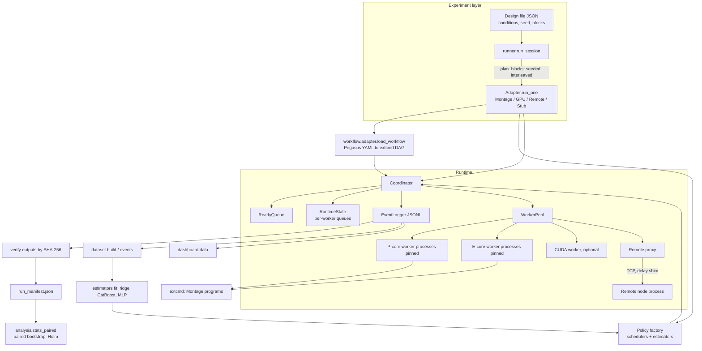
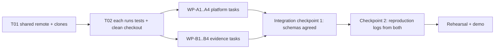

# PROJECT MASTER DOCUMENTATION

**Prediction-aware dynamic task scheduling for DAG workloads on heterogeneous CPU/GPU resources: how much prediction is enough?**

This is a read-only audit of the local project folder. It explains what the project is, how it works, what has been done, what has not, and how two people can divide the remaining work. Every claim names the file it comes from. Claims that were only read in a document, and not checked by this audit, are marked.

---

## Table of contents

1. [Title and report metadata](#1-title-and-report-metadata)
2. [Executive summary](#2-executive-summary)
3. [Project overview and problem statement](#3-project-overview-and-problem-statement)
4. [Current project status at a glance](#4-current-project-status-at-a-glance)
5. [Project directory structure](#5-project-directory-structure)
6. [File-by-file and module-by-module explanation](#6-file-by-file-and-module-by-module-explanation)
7. [Technology stack and dependencies](#7-technology-stack-and-dependencies)
8. [System architecture](#8-system-architecture)
9. [Component-by-component explanation](#9-component-by-component-explanation)
10. [End-to-end workflow](#10-end-to-end-workflow)
11. [Code-level implementation](#11-code-level-implementation)
12. [Algorithms and data structures](#12-algorithms-and-data-structures)
13. [Database and data management](#13-database-and-data-management)
14. [APIs and external integrations](#14-apis-and-external-integrations)
15. [Configuration and environment setup](#15-configuration-and-environment-setup)
16. [How to run, stop and test](#16-how-to-run-stop-and-test)
17. [Testing and verification results](#17-testing-and-verification-results)
18. [Git history and recent changes](#18-git-history-and-recent-changes)
19. [Features and requirements traceability](#19-features-and-requirements-traceability)
20. [Completed work](#20-completed-work)
21. [Partially completed work](#21-partially-completed-work)
22. [Pending work](#22-pending-work)
23. [Bugs, risks, technical debt and blockers](#23-bugs-risks-technical-debt-and-blockers)
24. [Two-member responsibility division](#24-two-member-responsibility-division)
25. [Integration and collaboration strategy](#25-integration-and-collaboration-strategy)
26. [Prioritized implementation roadmap](#26-prioritized-implementation-roadmap)
27. [Faculty review preparation](#27-faculty-review-preparation)
28. [Likely questions and answers](#28-likely-questions-and-answers)
29. [Important commands and reference paths](#29-important-commands-and-reference-paths)
30. [Unverified areas and limitations of this audit](#30-unverified-areas-and-limitations-of-this-audit)
31. [Final checklist](#31-final-checklist)
32. [Update 2026-10-24: Study 2](#32-update-2026-10-24-study-2-branch-study2affinity)
33. [Update 2026-11-02: final static-versus-dynamic benchmark](#33-update-2026-11-02-final-static-versus-dynamic-benchmark-supersedes-the-status-and-pending-lists-above-where-they-differ)

---

## 1. Title and report metadata

| Item | Value |
|---|---|
| Report file | `PROJECT_MASTER_DOCUMENTATION.md` (project root) |
| Audit date | 2026-10-14 |
| Project root | `D:\cao project` |
| Python package name | `caosched` version 0.1.0 (`pyproject.toml`) |
| Git branch audited | `redesign/montage`, HEAD `7dd1847`, working tree clean when the audit started (`git status` printed nothing) |
| Other branch | `main` at `7651eca` (the redesign branch is 13 commits ahead) |
| Git remote | **None configured** (`git remote -v` printed nothing), so "ahead or behind a remote" cannot be determined |
| Tags | None |
| Machine of this audit | Windows 11 Home Single Language 10.0.26200; NVIDIA GeForce RTX 3050 6GB Laptop GPU, driver 581.83 (read with `nvidia-smi`); Python 3.11.9 in `.venv` |
| Machine of the recorded experiments (per project documents) | Intel i5-13500HX, 15.7 GB RAM (`docs/research_redesign/RESEARCH_STATUS.md`); older phases used an i5-1235U (historical) |
| Audit method | Read the source, tests, configs, scripts and documents; ran the full test suite and the type checker; read (did not re-run) the stored experiment evidence |

### 1.1 How this audit was done, and what it changed

Changed by this audit: **one new file**, this report. Nothing else in the project was edited, deleted, renamed, installed or reconfigured.

Things the audit ran, all read-only with respect to the project:

- `pytest -q -p no:cacheprovider` with `PYTHONDONTWRITEBYTECODE=1`. After the run, `git status` was clean and no file under `data/` was newer than a marker file created before the run (checked with `find data -newer`).
- `mypy --ignore-missing-imports src/caosched` with its cache directory placed outside the project.
- `nvidia-smi`, `pip list`, and `git` read commands (`log`, `status`, `branch`, `shortlog`, `show --stat`, `diff --stat`, `ls-files`).

**Side effect to know about.** The first test launch silently kept running in a detached shell, so a second launch overlapped it for about two and a half minutes. This made the recorded duration longer than the documented one. I stopped the second pytest process, but the system refused my request to stop three of its leftover worker processes (they belong to the stopped run). They are probably idle `python.exe` processes. If Task Manager shows three `python.exe` processes started at about 21:13 on 2026-10-14 that you do not recognise, you can end them.

---

## 2. Executive summary

**What the project is.** A research code base, plus its experimental evidence, that asks one question: *when does predicting how long a task will run actually make a task scheduler produce a better schedule?* A "DAG" (directed acyclic graph) is a set of tasks where some tasks must wait for others. The project runs real DAG workloads on a real Windows laptop that has fast "P" cores, slow "E" cores, an NVIDIA GPU, and an emulated "remote" worker. It compares simple scheduling rules against rules that use runtime predictions (from a lookup table, from online learning, or from machine-learning models), and it measures the real end-to-end time (the "makespan").

**Headline result recorded by the project.** A confirmed *null result*: in four tested conditions, prediction-aware placement did not beat the strongest simple rule by the 2 % margin the authors pre-registered. This is a legitimate, honestly reported outcome and the project documents it as such (`docs/research_redesign/FINAL_REPORT.md`).

**Status in one paragraph.** The implementation is complete for the project's declared scope. The 393 automated tests passed in this audit, the type checker reported no issues in 79 source files, and the stored evidence directory is internally consistent with the documents (408 run manifests; all four gate files show 0 failing checks; sampled numbers in the analysis tables match the report). Not completed, and not claimed by the project: a Raspberry Pi 5 extension (no hardware), a real network (the remote pool is an emulation), more than one machine, a licence file, and the full text of several paywalled papers. I did **not** re-run any experiment, the Montage build, or the GPU benchmark, so "verified" below means "tests and consistency checks in this audit", and "documented" means "the project's own documents say so".

**Biggest practical risks.**
1. There is **no Git remote**, and the 36 GB `data/` folder (the raw evidence) is mostly outside Git. Everything lives on one disk.
2. Many project documents are dated snapshots. Several contradict later documents (section 23.4). A reviewer who opens the wrong file will see wrong statements.
3. The research claims depend on one machine and one dominant task type, so they are narrow by the authors' own admission.

**Work division proposed (section 24).** Member A takes the *execution platform* (runtime, schedulers, workload adapters, GPU and remote paths). Member B takes *prediction and evidence* (estimators, dataset, experiment design, statistics, dashboard, review material). Both share the interfaces between them.

---

## 3. Project overview and problem statement

### 3.1 The problem, from the ground up

- A **task** is a unit of work. A **DAG workflow** is many tasks plus "task B needs the output of task A" arrows. Scientific pipelines (for example building an astronomy image mosaic) are DAGs.
- Modern machines are **heterogeneous**: some processor cores are fast (P cores), some are slow but numerous (E cores), a GPU is fast at certain jobs but needs data copied to it, and a remote machine may be reachable only over a slower link.
- A **scheduler** decides *which worker runs which ready task, and when*. Good placement shortens the **makespan** (time from the first dispatch to the last completion).
- A scheduler that knows each task's runtime on each resource can place tasks better. But predictions cost time to make, can be wrong, and the benefit depends on the workload. Published learned schedulers are mostly tested in simulation and often ignore their own decision time (`docs/research_redesign/PROJECT_SPEC.md` section 6).

### 3.2 Research question and hypothesis (from `PROJECT_SPEC.md` sections 4-5)

> Under what workload and resource conditions does execution-time prediction improve dynamic DAG scheduling on heterogeneous resources, after accounting for prediction, scheduling, queueing and data-transfer overhead?

Primary hypothesis: prediction-aware placement beats the best non-predictive baseline only when the speed ratio between resources and the contention are large compared with prediction cost, scheduling cost and noise. Otherwise a simple method matches it. The project states that a null result is an accepted outcome.

Not claimed: a new learning algorithm, a new list-scheduling algorithm, or novelty of the "task graph + queues + eligibility" idea (a base patent, US 11,561,826 B1, covers that general idea; the project only uses a greedy eligible-worker rule as a *comparison baseline*, B4).

### 3.3 Target users, input, processing, output

| Aspect | Description |
|---|---|
| Target users | The two students (project review), faculty reviewers, and researchers who want a reproducible real-hardware scheduling testbed |
| Input | A workflow description (a Pegasus YAML file for Montage, or a built-in image-analysis DAG), a *design file* naming the policies to compare, and (for predictive policies) a measured runtime profile or a trained model |
| Processing | A coordinator runs the DAG on worker processes pinned to CPU cores (plus an optional CUDA worker and an optional emulated remote node). A scheduling policy chooses a worker per task. Every event is written to a log |
| Output | JSON-lines event logs, per-run manifests with SHA-256 output hashes, paired statistical tables (CSV/JSON), figures, and a browser dashboard |

### 3.4 Maturity and major limitations

Mature as a research testbed (many tests, pre-registered experiments, hash-checked outputs). Major limits (from `FINAL_REPORT.md` section 12, confirmed by reading the code and configs):

- One machine, one patched Windows build of Montage.
- Montage has one dominant task type (`mProject`, about 112 s on a P core versus 401 s on an E core, a ratio of 3.6). With three or more P workers, "use only P cores" is nearly optimal, so a null result was expected by construction.
- The "remote" pool is emulated on the same machine (loopback network, no jitter, same clock).
- The GPU workload is a separate, small image pipeline dominated by CPU stages (makespan about 7 s).

### 3.5 Explanations at different levels

**One sentence.** The project is a real-hardware testbed and study that measures whether predicting task runtimes makes DAG scheduling on a mixed P-core/E-core/GPU/remote machine measurably faster, and finds that, in the tested conditions, it did not beat a simple rule.

**For a faculty review (short).** We built a runtime that really executes DAG workflows (the Montage astronomy mosaic workflow and a GPU-capable image pipeline) on a hybrid laptop. We implemented 14 scheduling policies, from trivial rules to HEFT/PEFT and a predictive earliest-finish-time scheduler, and six runtime predictors, from a lookup table to CatBoost and a neural network. We compared them with pre-registered, paired, interleaved experiments (408 verified runs in the confirmatory round). The finding is a confirmed null: better prediction accuracy did not translate into shorter schedules by the practical margin, because the workload is dominated by one large task type whose best placement is obvious.

**Detailed technical.** See sections 8-12.

**Real-world example.** Imagine stitching 9 telescope photos into one sky picture. The job has 59 small programs; the 9 "reproject" programs take minutes each and everything else takes seconds. The laptop has 6 fast and 7 slow worker slots. A naive scheduler hands each program to the first free worker, so 3 of the 9 big programs land on slow cores and the job takes about 418 s. A rule "use only the fast cores" takes about 285 s. A predictive scheduler also takes about 290 s, because it reaches the same decision the simple rule does.

---

## 4. Current project status at a glance

Status words: **Verified here** = checked by this audit (tests, type check, consistency checks). **Documented** = the project's documents and stored evidence say so; not re-executed here. **Not done** = absent.

| Area | Status | Basis |
|---|---|---|
| Core runtime (coordinator, worker pools, eligibility, external-command tasks, event log) | Implemented. **Verified here** by tests | 393 tests passed |
| Policies B0-B5, random, B0 early-binding control, EFT, HEFT, PEFT, rank-EFT | Implemented. **Verified here** by tests | `tests/test_schedulers.py`, `test_heft_peft.py`, `test_heft_peft_papers.py` |
| Estimators E0-E3, E4 (ridge), +rc, CatBoost, MLP, E5 oracle (offline) | Implemented. **Verified here** by tests | `tests/test_estimators.py`, `test_models.py`, `test_est_identity.py` |
| Montage on Windows | Built natively (patched). **Documented**; run evidence present on disk | `docs/research_redesign/MONTAGE_WINDOWS_BUILD.md`, `data/results/stage1_20261011/` |
| 14-policy Montage matrix, 42 runs | **Documented** (`stage2_gate.json`, not re-run) | `data/results/stage2_20261012/` |
| Dataset and predictor evaluation | Code **verified here**; results **documented** | `data/results/stage3_20261012/` |
| Pilot and confirmatory sessions (408 confirmatory runs) | Run counts and gate files **checked here** (408 manifests; all gates `n_failing_checks` 0); results **documented** | `data/results/stage5_20261013/` |
| GPU workload (RTX 3050) | Implemented; results **documented** | `gpu_spike.json`, `S5/gpu_sessions` |
| Emulated remote pool | Implemented; results **documented**; label "emulation" | `S5/remote_sessions` |
| Dashboard | Implemented; server logic **verified here** by tests; not launched in a browser in this audit | `tests/test_dashboard.py` |
| Type checking | **Verified here**: `mypy --ignore-missing-imports`: "no issues found in 79 source files" | |
| Raspberry Pi 5, real network, ARM | **Not done** (no hardware; explicitly out of scope) | `FINAL_REPORT.md` 14.3 |
| Project licence file | **Not done** (owner's choice) | `FINAL_REPORT.md` 15.2 |
| Git remote / off-disk archive of `data/` | **Not done** | `git remote -v` empty |
| Continuous integration | None found (no `.github`, no CI file) | directory listing |

---

## 5. Project directory structure

Root inventory (tracked by Git unless noted; 2,076 tracked files in total, 1,850 of them under `data/`):

```
D:\cao project
├── README.md, ARCHITECTURE.md, PROGRESS.md, PROJECT_STATUS.md   top-level documents (partly historical)
├── pyproject.toml, requirements.txt, requirements-lock.txt      packaging and dependencies
├── .gitignore
├── config/            phase2..phase6b YAML settings (historical phases)
├── docs/              brief, dataset, dashboard, remote devices, patent mapping, and docs/research_redesign/ (the current project documents)
├── manifests/         Stage 0 SHA-256 manifest of data/
├── src/caosched/      the library (79 Python files + 3 dashboard static files)
├── scripts/           49 Python entry points + 6 shell chain scripts
├── tests/             42 test files + 1 helper (393 test cases)
├── data/              evidence and generated data (36 GB on disk; mostly NOT in Git)
├── .venv/             local virtual environment (ignored by Git)
└── .git/              34 MB
```

Counts: Python source in `src/caosched` is about 9,300 lines; dashboard static files about 1,240 lines; `scripts/` about 5,900 lines; `tests/` about 5,700 lines (line counts from `wc -l`).

### 5.1 Directory explanation table

| Path | Purpose | Important files | Current status |
|---|---|---|---|
| `src/caosched/core/` | Runtime: task model, DAG, coordinator, worker pool, ready queue, runtime state, eligibility, external-command tasks, event log, traces | `coordinator.py`, `worker_pool.py`, `task.py`, `dag.py`, `eligibility.py`, `extcmd.py` | Core implementation; tested |
| `src/caosched/schedulers/` | Scheduling policies | `simple.py` (B0-B5, random), `eft.py`, `heft.py`, `peft.py`, `rank_eft.py`, `__init__.py` (registry) | Core implementation; tested |
| `src/caosched/estimators/` | Execution-time predictors | `base.py`, `profile.py` (E1), `learned.py` (E4), `tabular.py` (CatBoost, MLP), `recalibrated.py`, `history.py`, `oracle.py` | Core implementation; tested |
| `src/caosched/experiment/` | Pre-registered design, session runner, manifests, adapters for Montage / GPU / remote | `design.py`, `runner.py`, `montage_adapter.py`, `gpu_adapter.py`, `remote_adapter.py`, `manifest.py`, `stub.py` | Core implementation; tested |
| `src/caosched/workflow/` | Pegasus YAML to DAG converter | `adapter.py` | Core implementation; tested |
| `src/caosched/apps/` | The 68-task tiled image pipeline with CPU and CUDA stages | `image_pipeline.py`, `stages.py`, `cuda_stages.py`, `artifacts.py` | Supporting; the GPU workload |
| `src/caosched/remote/` | Emulated remote worker: TCP protocol, node, proxy, link shim | `node.py`, `proxy.py`, `protocol.py`, `link.py` | Supporting; loopback-tested only |
| `src/caosched/dataset/` | Dataset from event logs, leakage-safe splits, data-collection policy | `build.py`, `events.py`, `splits.py`, `campaign.py` | Supporting |
| `src/caosched/analysis/` | Statistics, regret, model evaluation | `stats.py`, `stats_paired.py`, `decisions.py`, `model_eval.py` | Supporting |
| `src/caosched/dashboard/` | Local web dashboard (stdlib HTTP server + static page) | `server.py`, `data.py`, `live.py`, `static/` | Supporting |
| `src/caosched/phase0/` | Core-topology discovery (Windows API) and early benchmarks | `topology.py`, `env_record.py`, `benchmarks/` | Supporting; also required at runtime (pool layout comes from `topology.py`) |
| `src/caosched/util/` | Clock, thread pinning, provenance | `clock.py`, `threadpin.py`, `provenance.py` | Supporting |
| `scripts/` | Command-line entry points per phase and stage | see section 6.3 | Mixed: current (Stage 1-5) and historical (Phase 0-6B) |
| `scripts/chains/` | Shell scripts that ran the real sessions in order | `run_stage4.sh`, `run_stage5.sh`, `run_tests.sh` ... | Supporting; Windows Git-Bash style |
| `tests/` | pytest suite | 42 `test_*.py` files, `_exp_helpers.py` | Tests; passing |
| `config/` | YAML settings for the old phases 2-6B | `phase2.yaml` ... `phase6b.yaml` | Legacy (still read by old scripts) |
| `docs/` | Project brief, dataset schema, dashboard guide, remote-device status, phase B sweep, patent mapping | `PROJECT_BRIEF.md`, `DASHBOARD.md`, `DATASET.md` | Documentation; mostly historical |
| `docs/research_redesign/` | The current research documents: spec, protocol, plan, decisions, final report, reproduction | `FINAL_REPORT.md`, `RESEARCH_STATUS.md`, `PROJECT_SPEC.md`, `EVALUATION_PROTOCOL.md`, `REPRODUCE.md` | Documentation; authoritative but see section 23.4 |
| `docs/research_redesign/montage_build/` | Patches and shims used to build Montage on Windows | `patch_*.py`, `gccshim.c`, `compat.h`, `bin_win64_sha256.txt` | Supporting |
| `manifests/stage0_20261010/` | Stage 0 SHA-256 list of 12,627 data files | `data_sha256.tsv`, `MANIFEST.md` | Evidence record |
| `data/results/stage1_20261011 ... stage5_20261013`, `stage*_repro` | Evidence of the redesign stages (sessions, analyses, gates, manifests) | `stage5_20261013/` (961 tracked files) | Generated output; committed except `work/` dirs |
| `data/results/phase*`, `phaseB_*`, `phaseC_*`, `dataset_audit_*` | Evidence of the older phases | `phase6b_*` | Generated output; historical |
| `data/montage/` | Montage sources, Windows binaries, workflow instances, runs (1.7 GB) | `bin_win64/`, `instances/` | **Git-ignored**; recorded by hashes |
| `data/events`, `data/artifacts`, `data/datasets`, `data/dashboard_runs` | Raw event logs, artifacts, datasets, dashboard runs of the old phases | | **Not in Git** (Stage 0 record) |
| `data/models`, `data/profiles`, `data/traces`, `data/environment`, `data/benchmarks`, `data/reports`, `data/diagnostics` | Trained E4 models, E1 static profiles, saved traces, environment records, old benchmark outputs | | Small; mostly generated |
| `.venv/` | Virtual environment (Python 3.11.9) | | Ignored; working |

### 5.2 File classification

- **Core implementation:** `src/caosched/core/*`, `schedulers/*`, `estimators/*`, `experiment/*`, `workflow/adapter.py`.
- **Supporting implementation:** `apps/*`, `remote/*`, `dataset/*`, `analysis/*`, `dashboard/*`, `phase0/*`, `util/*`.
- **Configuration:** `pyproject.toml`, `requirements*.txt`, `config/*.yaml`, design JSON files under `data/results/*/designs/`.
- **Documentation:** the four root `.md` files, `docs/**`.
- **Tests:** `tests/*`.
- **Generated output:** `data/results/**`, `data/events`, `data/datasets`, `data/artifacts`, figures.
- **Legacy (kept for history, not the current target):** `config/phase*.yaml`, `scripts/phase0_*.py`, `run_phase4.py`, `run_phase5.py`, `run_phase6b.py`, `run_app_demo.py`, `analyze_app_*.py`; `PROJECT_STATUS.md`. The project's own policy marks the 68-task image pipeline as "no longer primary" but keeps it, because it is the GPU workload (`ARCHITECTURE_DECISIONS.md`, migration policy).
- **Uncertain or possibly obsolete:** `data/results/stage3_20261012/designs_v3/` (three design files never launched; purpose not recorded, `FINAL_REPORT.md` limitation 10); `PROGRESS.md` (a 2026-10-10 snapshot whose "uncommitted" statements are now outdated); `data/results/stage1_20261011/` first-attempt runs (kept on purpose, excluded by rule). I did not mark any code as unused.

---

## 6. File-by-file and module-by-module explanation

### 6.1 `src/caosched/core/` (runtime; about 2,000 lines)

| File | Lines | What it does |
|---|---:|---|
| `task.py` | 177 | `Task` dataclass (workload, size, dependencies, timestamps, eligibility, timeout), a strict state machine `PENDING -> READY -> DISPATCHED -> DONE/FAILED` that rejects illegal transitions, `TaskMessage` (coordinator to worker) and `TaskResult` (worker to coordinator). Properties `est_workload/est_size/est_bytes` define the identity every estimator uses |
| `dag.py` | 161 | `DAG`: validates (unknown dependency, cycle via Kahn's algorithm), keeps a per-task counter of unmet dependencies so readiness is O(1) per edge, topological order, critical-path length, pattern builders (independent, chain, fork-join, mixed) |
| `ready_queue.py` | 45 | Global FIFO of ready tasks (by ready time) |
| `runtime_state.py` | 138 | The coordinator's read-only view for policies: per worker the executing task and a local queue; `bind`, `finish`, busy-fraction over a time window, activity history kept across runs |
| `scheduler_base.py` | 97 | `SchedulerPolicy` abstract class (hooks `on_run_start`, `order_ready`, `select_worker`, `on_task_completed`, `retry_after`), `eligible_workers`, contract errors |
| `eligibility.py` | 69 | `resolve_eligibility`: before a run, decides which pools can execute each task kind and fails early (`EligibilityError`) instead of deadlocking |
| `runtime_config.py` | 100 | `PoolSpec` (slots, kind `cpu`/`cuda`/`remote`, allowed task types, memory limit), `RuntimeConfig`, and `from_topology()` that reads the real P/E layout |
| `worker_pool.py` | 438 | Persistent worker **processes** (spawn context), one per core slot, pinned with read-back verification; startup handshake; CUDA worker; remote proxy slots; kill of a hung worker's process tree; `RemoteSlot` |
| `coordinator.py` | 432 | The main loop (section 10) |
| `extcmd.py` | 182 | External-command task: runs a program without a shell, kills its process tree on timeout, checks exit status and declared outputs, records output size and SHA-256 |
| `event_log.py` | 64 | Append-only JSONL logger, flushed per line, refuses to overwrite |
| `trace.py` | 108 | Seeded synthetic workload traces (layered, independent, fork-join) saved as JSON and replayed |

### 6.2 Other `src/caosched/` packages

| Package | Summary |
|---|---|
| `schedulers/` | `simple.py`: B0 (one pool only, late binding), `PoolOnlyEarlyScheduler` (B0 with early binding, the controlled contrast), B1 round robin, B2 static type-to-pool map, B3 shortest queue, B4 greedy eligible (patent-inspired comparison baseline), B5 criticality (bottom level), random. `eft.py`: earliest-finish-time with a pluggable estimator. `heft.py`, `peft.py`: static plan methods. `rank_eft.py`: EFT with upward-rank ready order plus `FileTransferModel`. `__init__.py`: registries building a **fresh** policy and estimator per run |
| `estimators/` | `base.py` (interface, `EstimateContext`), `constant.py` (E0), `profile.py` (E1), `analytic.py` (E2), `history.py` (E3), `learned.py` (E4 ridge + base-profile binding rules), `tabular.py` (CatBoost, MLP), `recalibrated.py` (`+rc`), `oracle.py` (E5), `e2e.py` (end-to-end ablation terms), `profile_data.py` |
| `experiment/` | `design.py` (design file, seeded interleaved block plan, adapter contract), `runner.py` (session runner), `manifest.py`, `stub.py`, `montage_adapter.py`, `gpu_adapter.py`, `remote_adapter.py` |
| `workflow/adapter.py` | Pegasus YAML to extcmd DAG; stages raw inputs |
| `apps/` | `image_pipeline.py` (source, 16 tiles x (denoise, edges, features), mosaic, aggregate, package = 68 tasks for the default 4x4 grid), `stages.py`, `cuda_stages.py` (PyTorch-CUDA variants), `artifacts.py` |
| `remote/` | `protocol.py` (length-prefixed JSON frames, HMAC challenge, frame-size caps), `node.py`, `proxy.py`, `link.py` (latency/bandwidth shim, `TransferModel`) |
| `dataset/` | `events.py` (event log to task rows with decision-time context), `build.py` (dataset, manifest, exclusions), `splits.py` (instance/session/size/occupancy/time splits), `campaign.py` (random-occupancy data-collection policy) |
| `analysis/` | `stats.py` (paired log-ratio bootstrap, sign-flip test, Holm adjustment), `stats_paired.py` (Stage 4/5 analysis from raw logs, refuses to pool across machines/environments/code versions), `decisions.py` (one-step placement regret), `model_eval.py` (accuracy, latency, memory, selection rule) |
| `dashboard/` | `server.py` (loopback-only HTTP server, Host/Origin/token checks), `data.py` (read-only data layer), `live.py` (live image-pipeline run in a subprocess), `static/` (HTML/CSS/JS, five tabs) |
| `phase0/` | `topology.py` (Windows `GetSystemCpuSetInformation` via `ctypes`), `env_record.py`, `benchmarks/` (matmul, image filter, compression kernels used as the original benchmark workloads) |
| `util/` | `clock.py` (QueryPerformanceCounter timebase), `threadpin.py` (BLAS thread env vars), `provenance.py` (source SHA-256, free memory) |

### 6.3 `scripts/` by role

| Role | Scripts |
|---|---|
| Workload preparation (Stage 1) | `montage_prepare.py`, `montage_sequential.py`, `stage1_report.py`, `gpu_spike.py`, `profile_montage.py`, `profile_gpu_workload.py` |
| Run experiments | `run_experiment.py` (any design), `run_workflow.py` (one workflow, one policy), `make_stage{2..5}_designs.py`, `make_gpu_design.py`, `make_remote_design.py`, `calibrate_link.py`, `load_monitor.py`, `memory_preflight.py` |
| Data and models (Stage 3) | `build_dataset.py`, `evaluate_models.py`, `select_model_from_pilot.py`, `drift_check.py`, `learning_curve.py`, `regret_table.py` |
| Analysis and checks | `analyze_experiment.py`, `stage2_gate.py`, `make_manifest.py`, `reproduce_subset.py`, `reproduce_clean_checkout.py`, `make_diagrams.py`, `load_vs_runs.py` |
| Historical phases 0-6B | `phase0_*.py`, `run_dag.py`, `profile_static.py`, `run_baselines.py`, `collect_campaign.py`, `train_e4.py`, `evaluate_estimators.py`, `run_phase4/5/6b.py`, `derive_e2e_terms.py`, `diag_*.py`, `run_app_demo.py`, `analyze_app_*.py` |

### 6.4 `tests/` (42 files, 393 test cases)

Grouped: runtime (`test_coordinator`, `test_worker_pool`, `test_runtime_hardening`, `test_extcmd`, `test_eligibility`, `test_dag`, `test_task`, `test_ready_queue`, `test_runtime_state`, `test_clock`, `test_topology`, `test_trace`), policies (`test_schedulers`, `test_heft_peft`, `test_heft_peft_papers`, `test_phase4`, `test_e2e`), predictors and data (`test_estimators`, `test_est_identity`, `test_models`, `test_dataset`, `test_dataset_build`, `test_parity_leakage`), experiments and analysis (`test_experiment_design`, `test_experiment_runner`, `test_montage_adapter`, `test_gpu_adapter`, `test_remote_adapter`, `test_stage2_gate`, `test_stage3_designs`, `test_analysis_paired`, `test_analysis_extra`, `test_stats`, `test_profile_montage`, `test_figures`, `test_reproduce_clean_checkout`), apps and edge (`test_apps`, `test_cuda_stages`, `test_remote`, `test_workflow_adapter`, `test_workloads`), dashboard (`test_dashboard`).

---

## 7. Technology stack and dependencies

Versions below are the pinned ones in `requirements-lock.txt`. I cross-checked them against `pip list` in `.venv`: every locked package matches, and the environment additionally holds `mypy 2.4.0`, `mypy_extensions`, `pandas-stubs`, `types-PyYAML`, `types-requests`, `pathspec`, `librt`, `ast_serialize`, `pip`, `setuptools` and the editable `caosched` package, none of which are in the lock file. Python requirement: `>=3.11` (`pyproject.toml`); the venv is 3.11.9 (`.venv/pyvenv.cfg`).

| Technology | Version | Where used | Purpose | Evidence | Status |
|---|---|---|---|---|---|
| Python | 3.11.9 (venv) | everywhere | Language | `pyvenv.cfg` | In use |
| numpy | 2.4.6 | estimators, apps, remote, analysis | Arrays, ridge solve, image stages, MLP inference | imports in `src` | In use (direct) |
| pandas | 3.0.6 | one module in `src` (grep shows 1 file) | Tabular handling | `pyproject.toml`; 1 import | In use, light |
| scipy | 1.17.1 | one module in `src` | Cross-check statistics (Friedman/Wilcoxon) | `stats_paired.py` | In use, optional path |
| matplotlib | 3.11.2 | one `src` module, 2 scripts | Figures and diagrams | | In use |
| psutil | 7.2.2 | 13 `src` files | CPU affinity read-back, process-tree kill, memory preflight | | In use (critical) |
| Pillow | 12.3.0 | 4 `src` files | Gaussian blur and PNG output in the image pipeline; benchmark kernels | | In use |
| PyYAML | 6.0.3 | `workflow/adapter.py`, `design.py`, scripts | Read Pegasus workflows and YAML designs | | In use |
| CatBoost | 1.2.10 | `estimators/tabular.py` | Gradient-boosted log-correction predictor | | In use |
| PyTorch | 2.11.0+cu128 | `apps/cuda_stages.py`, `tabular.py` (MLP training), `worker_pool.py` | CUDA stage variants and MLP training; **not on PyPI**, needs the cu128 index | `pyproject.toml` marks it optional (`gpu`) | In use (optional extra) |
| astropy | 8.0.1 | `montage_adapter.py` (FITS comparison), Montage generator | Compare FITS mosaics; generator reads tables | | In use |
| requests | 2.34.2 | `scripts/montage_prepare.py` | Download Montage input images | | In use (script only) |
| pegasus-wms.api | 5.1.3 | the Montage generator `data/montage/montage-workflow-windows.py` | Writes the workflow YAML | not imported anywhere in `src` or `scripts` | Needed only to generate new instances |
| pytest | 9.1.1 | `tests/` | Test runner | | Development-only |
| mypy | 2.4.0 | not in lock | Type check | installed in venv; docs mention it | Development-only, unpinned |
| plotly, networkx, graphviz, sympy, Jinja2 | in lock | no import found in `src`, `scripts` or `tests` | none found | grep | **Locked but unused here**: likely transitive of other packages; not verified |
| scikit-learn | not installed | none | Mentioned as a comment in `requirements.txt` | | Not used |
| Standard library `http.server` | | dashboard | Local web server | | In use |
| TCP sockets, HMAC-SHA256 | stdlib | `remote/` | Emulated remote node and handshake | | In use |
| Win32 `GetSystemCpuSetInformation` via `ctypes` | Windows 10 2004+ | `phase0/topology.py` | Find P and E cores | | In use; **Windows only** |
| MinGW-w64 (w64devkit 2.10.0.7z, GCC 16.2.0), Make 4.4.1 | | Montage build | Build Montage natively on Windows | `MONTAGE_WINDOWS_BUILD.md` | Documented, not re-run |
| Montage toolkit | commit `ac0a1533...` | external programs | The workload | `REPRODUCE.md` section 2 | In use (git-ignored binaries) |
| Git | | version control | | | In use, no remote |
| Docker, databases, message queues, caches, authentication frameworks, CI | | | | none found | **Not used** |

**Dependency kinds.** Direct dependencies are those in `pyproject.toml` (`numpy`, `pillow`, `psutil`, `PyYAML`, `pandas`, `scipy`, `matplotlib`, `catboost`, `astropy`, `pegasus-wms.api`, `requests`). Optional: `gpu` (torch), `test` (pytest). Everything else in the lock file is transitive or development tooling. `requirements.txt` (a short, older list) differs from the lock and from `pyproject.toml`; the lock is the authority for exact versions. Note `pyproject.toml` lists `catboost`, `astropy`, `pegasus-wms.api` and `requests` as hard dependencies although only some code paths need them.

**Why each major technology.** psutil gives reliable core pinning and process-tree kill (without it, timing would be noisy and hung tasks could not be stopped). The Windows CPU-set API is the only documented way to tell P from E cores on Windows. CatBoost and the MLP are the "more sophisticated predictors" the research question asks about; ridge and lookup tables are the cheaper rungs. PyTorch supplies the GPU stages. Montage is a recognised, real scientific workflow.

---

## 8. System architecture

### 8.1 High-level component diagram (traced from the code)



### 8.2 Data-flow summary

1. A design file lists *conditions* (policy plus estimator plus options). `plan_blocks` makes blocks; each block runs **every condition once in a seeded random order**, so slow drift hits all conditions alike.
2. The adapter builds a fresh DAG and a fresh policy for each run, runs the coordinator, and verifies the final outputs by SHA-256 against a reference.
3. The event log is the raw record. Datasets, regret tables, statistics and the dashboard are all derived from logs, never from in-memory state.

### 8.3 Intended design versus actual implementation

The original design (`ARCHITECTURE.md`, written for phases 0-6) described P and E pools plus a remote pool "R", estimator rungs E0-E5, and Python workloads. The redesign (Stages 1-5) kept the runtime and replaced the workload with Montage. Differences that matter:

| Intended or older statement | Actual implementation |
|---|---|
| "No emulation" (`README.md` top line) | The remote pool is an *emulation* by design and labelled so; the main CPU results are real |
| Pool names P/E/R fixed | Pools are arbitrary named `PoolSpec`s, but several modules still assume P and E (section 11.4) |
| `ARCHITECTURE.md` "Later phases ... `experiments/`" | The package is named `experiment/` |
| GNN + PPO learned scheduler | Excluded by decision AD-11 |
| TabM predictor | Excluded by an entry rule (needs at least 20,000 rows; 2,706 available) |

---

## 9. Component-by-component explanation

| Component | Responsibility | Main files | Inputs | Outputs | Dependencies | Status |
|---|---|---|---|---|---|---|
| Coordinator | Run a DAG: bind tasks to workers through a policy, collect results, log everything, fail fast | `core/coordinator.py` | DAG, WorkerPool, policy, logger | `RunSummary`, event log | DAG, RuntimeState, EventLogger, eligibility | Implemented; tested |
| Worker pool | Spawn and supervise pinned worker processes; CUDA and remote slots | `core/worker_pool.py` | `PoolSpec`s, `RemoteSlot`s | `TaskResult`s, handshake records | psutil, multiprocessing, torch (CUDA only) | Implemented; tested |
| Eligibility | Decide capable pools per task before the run | `core/eligibility.py` | DAG, pool specs | narrowed `eligible_pools` or error | apps.stages | Implemented; tested |
| Extcmd tasks | Run external programs safely, record output hashes | `core/extcmd.py` | argv, cwd, declared files | outcome with hashes | psutil, subprocess | Implemented; one known gap (11.5) |
| Policies | Choose a worker per task | `schedulers/*` | `Task`, `RuntimeState` | worker id, decision record | estimators | Implemented; tested |
| Estimators | Predict kernel time per (task, pool, context) | `estimators/*` | task, pool, `EstimateContext` | seconds | profile or model files | Implemented; tested |
| Workflow adapter | Turn a Pegasus workflow into a DAG | `workflow/adapter.py` | YAML file | `LoadedWorkflow` | PyYAML | Implemented; tested |
| Experiment runner | Execute a design, keep failures as data, write manifests | `experiment/runner.py` | design, adapter | session directory | psutil, git (read-only) | Implemented; tested |
| Montage / GPU / Remote adapters | Run one condition once and verify output | `experiment/*_adapter.py` | `Condition`, workdir, seed | `RunRecord` | coordinator, policies | Implemented; tested |
| Remote node and proxy | Emulated remote worker over TCP with delay shim | `remote/*` | task messages | results with measured transfer time | sockets | Implemented; loopback only |
| Dataset builder | Turn logs into leakage-safe task rows | `dataset/*` | event logs | CSV, splits, manifest | pandas (light) | Implemented; tested |
| Analysis | Paired effects with bootstrap CIs; regret; model metrics | `analysis/*` | logs, manifests | CSV/JSON/figures | numpy, scipy (optional) | Implemented; tested |
| Dashboard | Local demo UI | `dashboard/*` | files on disk | web page | stdlib | Implemented; server logic tested |
| Topology discovery | Find P and E cores | `phase0/topology.py` | Windows API | `TopologyResult` | ctypes, WMI | Implemented; Windows only |

---

## 10. End-to-end workflow

### 10.1 Start-up and one Montage run (the main workflow)

Trigger: `python scripts/run_experiment.py --design <design.json> --out <dir> --adapter caosched.experiment.montage_adapter:factory` (`scripts/run_experiment.py`).

```mermaid
sequenceDiagram
    participant S as run_experiment.py
    participant R as runner.run_session
    participant A as MontageAdapter.run_one
    participant W as workflow.adapter
    participant C as Coordinator
    participant WP as WorkerPool
    participant L as EventLogger
    S->>R: design path, adapter
    R->>R: load_design; copy design, write sha256 + environment.json
    R->>R: memory preflight per block
    loop each block, each condition (seeded random order)
        R->>A: run_one(condition, workdir, seed)
        A->>W: load_workflow(YAML) -> DAG of extcmd tasks
        A->>A: prepare_workdir, stage raw inputs, hash inputs
        A->>A: build_policy(condition)
        A->>C: Coordinator(dag, pool, policy, log).run()
        loop until DAG complete
            C->>C: order_ready, select_worker (policy)
            C->>WP: submit TaskMessage
            WP-->>C: TaskResult (hashes, times)
            C->>L: task_* events
        end
        C->>L: run_finished (status, makespan, scheduling time)
        A->>A: compare final outputs to reference hashes
        A-->>R: RunRecord
        R->>R: write run_manifest.json (hashes, code, verification)
    end
    R->>R: write session.json (complete / aborted / crashed)
```

Step by step with the real symbols:

1. **Start-up.** `run_session` (`experiment/runner.py`) loads the design with `load_design`, which rejects missing fields, duplicate condition names and unknown evidence labels (`experiment/design.py`). It copies the design, writes its SHA-256 and `environment.json` (machine id, package versions, git commit and dirty flag, source SHA-256 from `util/provenance.py`).
2. **Validation and preflight.** A free-RAM check runs at session start and before each block; failure aborts cleanly with status `aborted`. If the design sets `run_timeout_s`, each run executes in a spawned child process that is killed (with its children) on expiry.
3. **Per run.** `MontageAdapter.run_one` loads the Pegasus YAML (`load_workflow`), clears a work directory that it created itself (`prepare_workdir` refuses to delete a directory it did not create), copies raw inputs, builds the policy with `build_policy`, and gets (or lazily creates) one `WorkerPool` shared by the whole session.
4. **Scheduling loop** (`Coordinator.run`): see 10.2.
5. **Output.** Final files (`1-mosaic.fits`, `1-mosaic_area.fits`, `1-mosaic.png`) are hashed and compared with the reference (`compare_outputs`); an optional FITS tolerance exists but the confirmatory sessions required identical bytes (documented). The runner writes `run_manifest.json` with `verification.passed`.
6. **Failure handling.** Exceptions become a recorded `failed` or `timeout` run that is kept and flagged; the pool is rebuilt after a failure. A run whose status is not `ok`, or which has no event log, never counts as verified. A crash that escapes leaves `session.json` status `crashed`, and the analysis excludes that session.
7. **Analysis.** `scripts/analyze_experiment.py` calls `analysis.stats_paired.analyze` on the raw directories only.

### 10.2 Coordinator loop (`core/coordinator.py`)

Trigger: `Coordinator.run`. Information moves as `Task` objects, `TaskMessage` to workers over `multiprocessing` queues, `TaskResult` back.

1. Up-front checks raise before anything is logged: no workers, DAG already run, dead workers, tasks in flight.
2. `resolve_eligibility` narrows each task's allowed pools or raises `EligibilityError`.
3. `run_started` is logged with the full DAG, task specs, software hash and free memory; then one `worker_ready` per worker (affinity requested versus actual, capabilities).
4. Dependency-free tasks are marked ready. Loop while the DAG is incomplete:
   - `_dispatch_ready_tasks`: `policy.order_ready`, then for each task `policy.select_worker` (timed; this time is the *scheduling overhead*). The coordinator checks the contract (worker exists, task is eligible there, late-binding policies chose an idle worker) and `_bind`s the task: an idle worker gets it at once, a busy worker queues it locally.
   - If nothing is executing and the policy is not deliberately waiting (`retry_after`), raise `DeadlockError`.
   - `poll_result`; `_handle_completion` validates the result matches the assignment, updates times and sizes, submits the worker's next local task, logs `task_completed` (with output hashes for external commands), calls `policy.on_task_completed` (feedback to the estimator), and marks newly ready dependents.
   - `_check_health`: dead workers, per-task timeout (+10 s grace; the worker is killed), run timeout.
5. On success `status="completed"`. On any exception: log `run_error`, re-raise; always log `run_finished` with `failure_reason` and a terminal status for **every** task (`done`, `failed`, `timeout`, `worker_died`, `aborted`, `not_run`).

Failure policy is **fail fast, no retry** (decision AD-3): a silent retry would corrupt measurements.

### 10.3 Early versus late binding (why the policy comparison is subtle)

*Late binding* policies (B0, B2, B4, B5, random) pick only idle workers; tasks wait in the global ready queue. *Early binding* policies (B1, B3, EFT, HEFT, PEFT, B0 early) may queue a task behind a busy worker. The project found that early binding explains the 1.4-1.7 % deficit of EFT/HEFT/PEFT against late-binding B0 P-only, and tested it with the controlled condition `B0_P_early` (`FINAL_REPORT.md` section 8.2; documented).

### 10.4 Other workflows

| Workflow | Trigger and path | State |
|---|---|---|
| GPU workload | `GpuAdapter.run_one`: build 68-task image pipeline, add a CUDA pool `G` only if the design's stage table says a stage passed the GPU spike, run, re-run CUDA tasks on CPU from their own inputs and compare within tolerances | Implemented; documented results |
| Emulated remote pool | `RemoteAdapter`: node process on one E core behind a loopback socket with delay shim; pools P, E, R in every condition | Implemented; label `emulation` |
| Dataset building | `scripts/build_dataset.py` and `scripts/evaluate_models.py` read event logs, rebuild decision-time features, fit ridge/CatBoost/MLP, evaluate on held-out instances | Implemented; documented results |
| Dashboard | `python -m caosched.dashboard --open` serves `http://127.0.0.1:8765/` | Implemented; not launched in a browser by this audit |

---

## 11. Code-level implementation

### 11.1 Entry points

- Library: `import caosched` (editable install). No `main` in the package except `python -m caosched.dashboard` and `python -m caosched.remote.node`.
- CLI: `scripts/*.py` (section 6.3).
- Adapter entry points loaded by name: `caosched.experiment.montage_adapter:factory`, `gpu_adapter:factory`, `remote_adapter:factory`, each reading an optional JSON config named by `CAO_MONTAGE_ADAPTER_CONFIG`, `CAO_GPU_ADAPTER_CONFIG`, `CAO_REMOTE_ADAPTER_CONFIG`.

### 11.2 Important classes and functions

| Symbol | File | Role |
|---|---|---|
| `Coordinator.run`, `_dispatch_ready_tasks`, `_handle_completion`, `_check_health` | `core/coordinator.py` | Main loop and failure handling |
| `WorkerPool`, `_worker_loop`, `RemoteSlot` | `core/worker_pool.py` | Worker processes |
| `run_extcmd`, `kill_tree`, `prepare_workdir` | `core/extcmd.py` | Safe external commands |
| `resolve_eligibility`, `eligible_workers` | `core/eligibility.py`, `scheduler_base.py` | One eligibility rule for all policies |
| `EarliestFinishTimeScheduler.select_worker` | `schedulers/eft.py` | `finish = wait + transfer + exec` per candidate; logs every candidate |
| `heft_plan`, `peft_plan`, `earliest_slot` | `schedulers/heft.py`, `peft.py` | Static plans |
| `EstimateContext.from_state` | `estimators/base.py` | Occupancy snapshot used identically online and offline |
| `InterferenceRidgeEstimator`, `resolve_base_profile` | `estimators/learned.py` | E4 and the base-profile binding rule |
| `CatBoostEstimator`, `MlpEstimator`, `encode` | `estimators/tabular.py` | Log-correction predictors |
| `load_workflow`, `stage_raw_inputs` | `workflow/adapter.py` | YAML to DAG |
| `run_session`, `plan_blocks`, `load_design` | `experiment/runner.py`, `design.py` | Experiment execution |
| `analyze`, `paired_effect`, `holm_adjust` | `analysis/stats_paired.py`, `stats.py` | Statistics |
| `decision_rows` | `analysis/decisions.py` | One-step regret |

### 11.3 Configuration, logging, errors

- Configuration: the old phases read `config/phase*.yaml` (settings only, "no measured values are ever written into" them). The redesign uses JSON/YAML design files and adapter-config JSON. Secrets: none found. A grep for quoted key/secret/token assignments outside `data`, `.venv`, `.git` found no matches. The only credential-like names are environment variables: `CAO_REMOTE_TOKEN` (remote node shared secret), and the dashboard token that is generated randomly at server start (`dashboard/server.py`, `TOKEN`).
- Logging: every state transition goes to the JSONL event log with a strictly increasing `seq` and a QueryPerformanceCounter timestamp (`util/clock.py`). There is no Python `logging` configuration.
- Error handling: typed exceptions (`TaskFailedError`, `TaskTimeoutError`, `WorkerDiedError`, `DeadlockError`, `RunTimeoutError`, `SchedulerContractError`, `EligibilityError`) map to `failure_reason` codes.
- TODO/FIXME: none in `src/` or `scripts/`. `NotImplementedError` appears only for abstract methods and for unsupported workflow features (sub-workflows, stdin/stderr). `shortcut:` notes mark known limits: `core/extcmd.py:39` (kill_tree), `dashboard/data.py:335` and `:363`.

### 11.4 Findings: confirmed facts, risks, suspicions

| # | Type | File and symbol | Evidence | Note |
|---|---|---|---|---|
| F1 | Confirmed limitation | `core/extcmd.py: kill_tree` | The `shortcut:` comment says a grandchild already re-parented before the kill is missed; a Windows Job Object would close it | Only matters if a tool double-forks; Montage runs did not show it (documented) |
| F2 | Risk | `estimators/base.py: EstimateContext` (`busy_P`, `busy_E`), `estimators/learned.py: FEATURES`, `schedulers/simple.py: B5`, `dashboard/live.py` | String matches for `"P"`/`"E"` in 11 `src` files; the AD-4 note says a repo-wide audit of hard-coded pool names "was not done" | Works for the tested P/E/R layouts; generalising to arbitrary pool names would need these touched. Not a bug today |
| F3 | Known approximation | `schedulers/rank_eft.py: on_run_start` | Docstring: the rank's communication term averages over all pools, so ranks are "HEFT-like, not HEFT-exact" | Stated in the code |
| F4 | Known limitation | `schedulers/eft.py` | Kernel-only model ignores `prepare()` and runtime overhead, so waits on busy workers are underestimated | Stated; an end-to-end ablation exists |
| F5 | Known limitation | `dashboard/server.py` | The token only blocks cross-origin browser requests; any local process can read it from the page | Stated in the module docstring |
| F6 | Known limitation | `remote/protocol.py` | Payloads are not encrypted; non-loopback binds need a token of at least 32 bytes | Stated; loopback-tested only |
| F7 | Suspicion (unverified) | `pyproject.toml` vs `requirements-lock.txt` | `plotly`, `networkx`, `graphviz`, `sympy`, `Jinja2` are in the lock but no import was found | Probably transitive of `pegasus-wms` or others; not checked |
| F8 | Documentation inconsistency | `scripts/calibrate_link.py:1` | The docstring ends with "[not yet run]", but `data/results/stage5_20261013/remote/remote_profile.json` exists | The note is stale |

No failing behaviour or reproducible bug was found in this audit.

---

## 12. Algorithms and data structures

| Algorithm / structure | Purpose | Where | Input to output | How it works | Complexity (stated where the code or sources justify it) | Complete? Tested? |
|---|---|---|---|---|---|---|
| DAG with per-task unmet-dependency counters | Readiness in O(1) per edge, no rescans | `core/dag.py` | tasks to ready set | A task becomes ready exactly when its counter hits zero | O(V+E) build | Yes; `test_dag.py` |
| Kahn's topological sort and cycle detection | Reject cyclic graphs at construction | `core/dag.py` | tasks to order or `CycleError` | Repeatedly remove zero-in-degree nodes | O(V+E) | Yes; tested |
| Task state machine | Reject illegal lifecycle changes | `core/task.py` | state to state | Allowed-transition table | O(1) | Yes; `test_task.py` |
| FIFO ready queue; early/late binding with local queues | Baselines and queue-aware policies | `ready_queue.py`, `runtime_state.py` | | | O(1) | Yes |
| Round robin, shortest queue, greedy eligible, criticality (bottom level), pool-only, random | Baselines B0-B5 | `schedulers/simple.py` | task to worker | See docstrings | Per decision O(workers) (B5 precompute O(V+E)) | Yes; `test_schedulers.py` |
| Earliest finish time (EFT) | Predictive placement: `F = wait + transfer + exec` | `schedulers/eft.py` | task to argmin worker | Estimate each candidate's wait from executing and queued tasks, each estimated under its own decision-time context | O(workers x queued tasks) per decision | Yes; `test_schedulers.py`, `test_phase4.py` |
| HEFT | Static plan: upward rank, insertion-based earliest finish | `schedulers/heft.py` | DAG, cost matrix to plan | Sort by decreasing rank, place on processor with smallest EFT | Sources give O(v^2 p); not re-derived here | Yes; reproduces the paper's worked example (makespans 80, 122, 133 per documents; `test_heft_peft_papers.py` passes) |
| PEFT | Static plan with optimistic cost table | `schedulers/peft.py` | | OCT and `rank_oct`, minimise `EFT + OCT` | Sources give O(v^2 p) | Yes; tested |
| Rank-priority EFT | The study's "instrument": EFT with upward-rank ready order | `schedulers/rank_eft.py` | | | | Yes; approximation F3 |
| E0-E3 profile estimators | Predictors without learning | `estimators/constant.py`, `profile.py`, `analytic.py`, `history.py` | | Medians, power law `a*size^b`, moving mean | O(1) lookup | Yes |
| E4 ridge (interference) | `t = E1 * exp(w . x(ctx))` per (workload, pool) | `estimators/learned.py` | context to seconds | Ridge regression on log(observed/E1); intercept unpenalised | Fit per group; inference microseconds | Yes; base-profile binding rule tested |
| CatBoost and MLP log-correction | Heavier predictors | `estimators/tabular.py` | features to log correction | Gradient-boosted trees; small ReLU network trained with torch, inference in numpy | CatBoost inference about 0.5 ms vs ridge 6 us (documented) | Yes |
| Online recalibration (`+rc`) | Per-pool EWMA multiplier from completions | `estimators/recalibrated.py` | | `factor = exp(EWMA(log(actual/predicted)))`, clamped | O(1) | Yes |
| Replay oracle E5 | Offline hindsight reference | `estimators/oracle.py` | | Median of the same task's time in other logged runs | | Yes; never used online |
| Link shim | Make loopback TCP behave like a slower link | `remote/link.py` | bytes to delay | `latency + per_message + bytes/bandwidth`, sleep then spin | | Yes |
| Interleaved block design with seeded shuffles | Cancel drift | `experiment/design.py` | design to run plan | Every condition once per block, SHA-256-derived seeds | | Yes |
| Paired log-ratio bootstrap, sign-flip test, Holm adjustment | Effect sizes and significance | `analysis/stats.py` | block metrics to CI and p | Percentile bootstrap within instance strata; exact sign-flip; Holm across conditions | | Yes; `test_stats.py` |
| One-step placement regret | Judge each decision against a hindsight oracle | `analysis/decisions.py` | logs to regret | Compare chosen worker's finish with the best alternative under E5 times | | Yes; myopic by design |
| Leakage-safe splits | Honest held-out evaluation | `dataset/splits.py` | rows to folds | Split by instance, session, size, occupancy or time; never random rows | | Yes; `test_parity_leakage.py` |
| SHA-256 manifests | Evidence integrity | `experiment/manifest.py` | files to digests | | | Yes |
| HMAC-SHA256 challenge-response | Authenticate remote node and proxy | `remote/protocol.py`, `node.py` | | Nonce challenge, constant-time compare, mutual | | Yes; loopback |

---

## 13. Database and data management

**No database is used.** Storage is the file system:

| Data | Format and location | Written by | Notes |
|---|---|---|---|
| Event logs | JSON lines, one file per run (`<run>.jsonl`), made read-only after the run | `core/event_log.py`, `experiment/runner.py` | Never overwritten (exclusive create) |
| Run manifests | `run_manifest.json` per run | `experiment/runner.py` | Holds condition, code version, hashes, verification, log hash |
| Session records | `session.json`, `design.json`, `design.sha256`, `environment.json`, `preflight.jsonl` | `experiment/runner.py` | Status `complete`, `aborted` or `crashed` |
| Profiles, models | JSON under `data/profiles`, `data/models` | `scripts/profile_*.py`, `train_e4.py`, `evaluate_models.py` | A model records its `base_profile`; load refuses a mismatch |
| Datasets | `tasks.csv`, `candidates.csv`, `splits.json`, `manifest.json` under `data/datasets` and `data/results/stage3_*/dataset` | `dataset/build.py` | Schema in `docs/DATASET.md` |
| Montage work files | `<run>/work/` (about 2 GB each) | extcmd tasks | `cleanup_work` deletes a verified run's work directory; hashes and logs stay |
| Application artifacts | `data/artifacts/<run>/<task>.bin` | `apps/artifacts.py` | Atomic writes |
| Evidence manifests | `SHA256_MANIFEST.tsv` per session, per stage; Stage 0 `manifests/stage0_20261010/data_sha256.tsv` | `scripts/make_manifest.py` | `verify` reports changed, missing, extra files |

CRUD: create is exclusive; read is by the analysis and dashboard; update and delete are deliberately absent (except `prepare_workdir`, which deletes only a directory carrying its own marker file, and `cleanup_work`). There are no transactions, indexes or migrations. Backup: Stage 0 recorded a copy at `D:\cao_backups\...` and notes (in `RESEARCH_STATUS.md`) that this folder does not exist on the current machine; the backup and data share one physical disk. Test versus production data: tests write to `tmp_path`; the audit's post-run check found no changed file under `data/`.

Duplicate or conflicting storage: none found. Historic event-log directories exist for the older phases next to the new session directories; they are separate by name and date.

---

## 14. APIs and external integrations

### 14.1 Local dashboard HTTP API (`dashboard/server.py`; binds only to 127.0.0.1)

| Endpoint | Method | Handler | Input | Output | Auth | Status |
|---|---|---|---|---|---|---|
| `/`, `/app.css`, `/app.js` | GET | `STATIC_FILES` | none | static page (token injected) | Host header must be loopback | Implemented; tested |
| `/api/system` | GET | `data.system_snapshot` | none | topology, per-CPU load, memory, live-run state | Host check | Implemented |
| `/api/sessions`, `/api/run`, `/api/artifact` | GET | `data.accepted_sessions/run_view/artifact_png` | session, run, which | JSON or PNG | Host check | Implemented; tested; path traversal tested (404) |
| `/api/comparison`, `/api/hardware`, `/api/gpu` | GET | `data.*` | none | JSON | Host check | Implemented |
| `/api/live`, `/api/montage/runs`, `/api/montage/run` | GET | `data.*` | id | JSON | Host check | Implemented; tampered-log detection tested |
| `/api/live/start` | POST | `LiveManager.start` | `{"policy": B4|EFT, "k": 1|4|16|64}` | session info | Host + same-origin Origin + `X-CAO-Token` | Implemented; auth matrix tested (400/403 cases) |

Errors: 403 forbidden host or token, 404 not found, 400 bad input, 409 run already in progress, 500 with the exception text. No rate limiting.

### 14.2 Remote node protocol (`remote/protocol.py`)

Frame = 4-byte header length + JSON header + payload; header carries `payload_len`; sizes are capped before allocation. Operations: `hello`, `task`, `stage`, `bye`. Authentication: challenge nonce, HMAC-SHA256 with a shared token, mutual. Timeouts: 10 s pre-authentication; proxy default 60 s. Retries: none. Tested on loopback; never against a second host.

### 14.3 External integrations

- Montage input images are downloaded once by `scripts/montage_prepare.py` (`requests`) from the archive URLs recorded in `instance.json`; the host must still serve identical files (not re-checked).
- Montage and its generator come from public GitHub repositories at pinned commits (`REPRODUCE.md` section 2).
- No cloud service, no external API with side effects.

---

## 15. Configuration and environment setup

| Item | Where | Note |
|---|---|---|
| Interpreter | Python 3.11 or later | `pyproject.toml`; venv is 3.11.9 |
| Package install | `pip install -e .` | Editable; `src` layout |
| Exact versions | `requirements-lock.txt` | `torch==2.11.0+cu128` is not on PyPI: install it from `https://download.pytorch.org/whl/cu128` |
| Platform | Windows 10 (build 2004 or later) or 11 | Topology discovery uses a Windows API; `RuntimeConfig.from_topology()` raises on other systems |
| Hardware assumed | Hybrid Intel CPU (P and E cores) for the real experiments; NVIDIA GPU for the GPU workload | The CPU-only parts and tests run without a GPU |
| Montage | Built natively into `data/montage/bin_win64/`; hashes in `docs/research_redesign/montage_build/bin_win64_sha256.txt` | **No script rebuilds Montage**; it was built by hand (documented in `MONTAGE_WINDOWS_BUILD.md`) |
| Environment variables | `CAO_MONTAGE_ADAPTER_CONFIG`, `CAO_GPU_ADAPTER_CONFIG`, `CAO_REMOTE_ADAPTER_CONFIG` (paths to JSON), `CAO_REMOTE_TOKEN` (secret, set at run time, never stored) | No `.env` or secret file exists |
| Machine hygiene for timed runs | Idle machine, **AC power connected**, free RAM at least 2.5-3 GB | The one slow window in the confirmatory main session coincided with the laptop running on battery |

---

## 16. How to run, stop and test

All commands use the existing project scripts and PowerShell syntax. Replace `<...>` placeholders.

**Set up (once).**
```powershell
py -3.11 -m venv .venv
.venv\Scripts\python.exe -m pip install -r requirements-cpu.txt
.venv\Scripts\python.exe -m pip install --no-deps -e .
```
`requirements-cpu.txt` does not exist in the repository. Create it as a copy of `requirements-lock.txt` without the `torch==...` line and the editable-install comment (`REPRODUCE.md` section 1; `scripts/reproduce_clean_checkout.py` does the same automatically).
GPU extra: `.venv\Scripts\python.exe -m pip install torch==2.11.0+cu128 --index-url https://download.pytorch.org/whl/cu128 --extra-index-url https://pypi.org/simple`.

**Run the tests (safe; uses temporary directories).**
```powershell
.venv\Scripts\python.exe -m pytest -q -p no:cacheprovider
```

**Type check.**
```powershell
.venv\Scripts\python.exe -m mypy --ignore-missing-imports src/caosched
```

**Dry run of the experiment pipeline with the synthetic adapter (label `plan`, never evidence).**
```powershell
.venv\Scripts\python.exe scripts\run_experiment.py --design <design.json> --out <tmp dir> --adapter stub
```

**Run a real design (needs `data/montage/`, an idle machine on AC power).**
```powershell
$env:CAO_MONTAGE_ADAPTER_CONFIG = "<adapter_config.json>"
.venv\Scripts\python.exe scripts\memory_preflight.py --min-free-gb 3
.venv\Scripts\python.exe scripts\run_experiment.py --design <design.json> --out data\experiments --adapter caosched.experiment.montage_adapter:factory --session-id <ID>
```

**Analyse, verify, reproduce from raw logs.**
```powershell
.venv\Scripts\python.exe scripts\analyze_experiment.py --sessions data\experiments\<ID> --out analysis\<NAME> --reference B0_P_only --seed 0
.venv\Scripts\python.exe scripts\make_manifest.py data\experiments\<ID> --verify
.venv\Scripts\python.exe scripts\reproduce_subset.py --analysis-dir analysis\<NAME> --log analysis\<NAME>_reproduction_log.json
```

**Clean-checkout test (clones the branch into a new empty directory; run when the machine is idle).**
```powershell
.venv\Scripts\python.exe scripts\reproduce_clean_checkout.py --dest <NEW EMPTY DIR OUTSIDE THE REPO>
```

**Dashboard.**
```powershell
.venv\Scripts\python.exe -m caosched.dashboard --open
```
Stop it with Ctrl+C. Open `http://127.0.0.1:8765/`. The five tabs are system overview, application workflow, scheduling comparison, hardware expansion, and Montage and GPU (`docs/DASHBOARD.md`).

**Stop a running session.** There is no stop command; interrupting the process leaves `session.json` with status `crashed`, and the analysis excludes that session. Worker processes are daemon processes and are terminated on pool shutdown.

**Access to results.** Per-session folders under `data/results/stage5_20261013/` hold `analysis_*/effects.csv`, `summary.csv`, `figures/`.

---

## 17. Testing and verification results

| Test / check | Purpose | Command | Result | Evidence | Limitation |
|---|---|---|---|---|---|
| Full pytest suite | Behaviour of runtime, policies, estimators, data, analysis, adapters, remote, dashboard | `python -m pytest -q -p no:cacheprovider --durations=10` | **Passed in this audit: 393 passed, 0 failed, 0 skipped, 263 s** | Captured pytest output; the same count the project records (393 passed, 150.95 s, `FINAL_REPORT.md` 14.1) | Slower than documented because another suite overlapped for about 2.5 minutes (section 1.1). Tests use synthetic data and temporary directories; they do not re-run Montage |
| Test side effects | Confirm tests do not alter the project | `find data -newer <marker>`; `git status` | **No file under `data/` changed; `git status` clean** | This audit | Limited to files newer than the marker |
| mypy | Static types | `mypy --ignore-missing-imports src/caosched` | **Passed in this audit: "Success: no issues found in 79 source files"** | | Needs `--ignore-missing-imports`; without it the project documents 16 `import-untyped` messages (not re-run) |
| Evidence consistency | Do stored files match the report | file reads | **Checked here:** 408 `run_manifest.json` files (108 + 48 + 168 + 84); each session's `session.json` has status `complete` with all blocks done; the four `gate_*.json` files show `n_failing_checks` 0; `analysis_main/effects.csv`: EFT_E1 +1.6188 % and `p_holm` 0.036; `analysis_regimeR`: B0_P_only +42.48 %, EFT_CatBoost +15.65 %, EFT_E1 -0.13 %; `analysis_gpu`: EFT_E1_gpu -2.10 %, `p_holm` 0.0006 | `data/results/stage5_20261013/` | I read these values; I did not recompute them from the raw logs |
| Stored re-derivation checks | Re-derive tables from raw logs and re-check hashes | `scripts/reproduce_subset.py` | **Documented, not re-run here:** `ok` true for main, scarce-P, GPU, remote | `data/results/stage5_repro/repro_analysis_*.json` | Not executed by me |
| Stored clean-checkout run | Fresh clone, fresh venv, full tests, stub experiment | `scripts/reproduce_clean_checkout.py` | **Documented, not re-run here:** 19 of 19 steps at commit `ebc68fb` | `data/results/stage5_repro/repro_clean_checkout_final.json` | Cannot rerun Montage or timings |
| Hash check of the 12,627 Stage 0 files | Historical data unchanged | | **Documented:** 0 missing, 0 changed | `stage4_repro/historical_data_verify.json` | Not re-run; hashing 36 GB was not attempted |
| Experiments, Montage build, GPU spike | | | **Not run** | | Would need an idle, AC-powered machine and hours; they write large outputs |

CI workflows, linters other than mypy, coverage and benchmarks: none found. Performance numbers in this report are the project's recorded ones.

---

## 18. Git history and recent changes

Fifteen commits, two author names (`git shortlog -sne --all`): **Venkatesh** 13, **Bharath Reddy** 2. Recorded authorship is evidence of *who made the commit*, not proof of who wrote each line. Notably the first commit is a snapshot of a project that already existed.

| Change / feature | Evidence | Current state | Confidence | Notes |
|---|---|---|---|---|
| Baseline snapshot of the original project (Phases 0-6B: runtime, B0-B7, E0-E5, remote shim, dataset, dashboard) | `c23a96e`, 2026-10-10, Bharath Reddy; 215 files, 85,053 insertions | Present | High that this commit exists; **low** that the named person wrote the code | A single snapshot commit; no earlier history. The code's earlier authorship is **unknown / not established** |
| Stage 0 data manifest (12,627 files) and exclusion record | `7651eca`, 2026-10-10, Bharath Reddy; 2 files | Present on `main` | High | `main` points here |
| E4 base-profile binding fix (audit finding D2) | `4df01e0`, 2026-10-11, Venkatesh; 3 files, +197/-10 | Present, tested | High | The fix and its tests are in `estimators/learned.py`, `__init__.py`, `tests/test_estimators.py` |
| Stage 1: Montage built on Windows, frozen workload, sequential reference runs, GPU spike | `6c94a89`, 2026-10-12, Venkatesh; 65 files | Present | High | Evidence in `data/results/stage1_20261011/` |
| Stage 2: heterogeneous runtime, 14 policies, 42 verified runs | `2019a34`, 2026-10-12; 198 files | Present | High | Includes extcmd, eligibility, capability model, HEFT/PEFT |
| Stage 3: dataset, predictors, held-out evaluation, scheduling pilot, model selection | `4b66dcc`, 2026-10-12; 293 files | Present | High | Includes the Stage 4 pre-registration |
| Stage 4 sessions, scarce-P regime, GPU workload, analysis, report | `f5bf2e6`, 2026-10-13; 377 files | Present | High | |
| Final clean-checkout reproduction and status updates | `6009ffe`, 2026-10-13 | Present | High | |
| Confirmatory design (pre-registration section 13), early-binding control policy, drift/learning-curve/regret analyses | `13d1649`, 2026-10-13 12:19 +0530 | Present | High | First confirmatory run 16 s later (documented) |
| Pre-registration of the emulated remote-pool session, design, calibration, tooling | `868eeea`, 2026-10-14 04:52 +0530 | Present | High | |
| Confirmatory sessions, emulated remote pool, closed literature/licence gaps, final report | `1eba22a`, 2026-10-14; 929 files, +257,594 | Present | High | Mostly evidence data |
| Dashboard tests skip when historical logs are absent | `ebc68fb` | Present | High | Makes a clean checkout pass |
| Slow-window cause identified (laptop on battery) | `5ed02d8` | Present | High for the commit; the cause is **documented, not re-verified** here | |
| Fix stale statements in final documents | `7dd1847` (HEAD) | Present | High | |

State: nothing is staged, modified or untracked at the start of the audit (this report becomes the one untracked file). Stash: none seen. `main..HEAD` is 1,911 files changed, +555,656/-2,985, mostly committed evidence. Whether a reliable work history can be reconstructed: **partly**. Commits after `4df01e0` form a clean chronological record. For who contributed what, the history cannot answer, because the baseline is one snapshot and the project documents state that many decisions were "made by the assistant under the project owner's delegation" (`FINAL_REPORT.md` section 14). The two of you should state your own contributions explicitly in the review.

---

## 19. Features and requirements traceability

The project's own scope document is `docs/research_redesign/PROJECT_SPEC.md` (with `EVALUATION_PROTOCOL.md`, `FOUR_STAGE_IMPLEMENTATION_PLAN.md`). The IDs below are this audit's labels for those documents' requirements. No separate official requirements list was found; treat the list as derived from them.

| ID | Requirement / objective | Planned behaviour | Implementation evidence | Status | Gap | Verification needed |
|---|---|---|---|---|---|---|
| R1 | A real, reproducible scientific workflow | Montage mosaic, 59 jobs, identical output in repeated runs | `data/results/stage1_20261011/valid/stage1_gate.json` (documented); `workflow/adapter.py`; `tests/test_workflow_adapter.py` | Implemented; evidence documented | Patched Windows build; one sky region | Re-run `montage_sequential.py` on the same machine |
| R2 | Real DAG runtime on heterogeneous pools with safe failure handling | Pinned workers, eligibility, timeouts, process-tree kill | `core/*`; `test_coordinator`, `test_runtime_hardening`, `test_extcmd` | Implemented; **tests pass here** | `kill_tree` re-parenting gap | Job Object test if needed |
| R3 | A ladder of baselines and published algorithms | B0-B5, random, HEFT, PEFT, EFT, rank-EFT | `schedulers/*`; paper examples reproduced by test | Implemented; **tests pass here** | HEFT/PEFT use averaged-communication approximation in rank-EFT; PEFT IEEE article unread | None for scope |
| R4 | A ladder of predictors, cheap to sophisticated | E0-E3, +rc, E4, CatBoost, MLP, E5 | `estimators/*` | Implemented; **tests pass here** | TabM excluded by rule | None |
| R5 | Decision-time-safe features, no train/serve skew or leakage | Same `EstimateContext` online and offline; leakage-safe splits | `dataset/*`, `test_parity_leakage.py` | Implemented; **tests pass here** | Logs from before context logging are dropped | None |
| R6 | Held-out predictor evaluation and a pre-fixed selection rule | Withheld instance `d1.5`, rule fixed before pilot | `analysis/model_eval.py`, `STAGE3_FREEZE.md`, `eval/*` | Implemented; results documented | Few rows (2,706); one sky region | Re-run `evaluate_models.py` |
| R7 | Count overhead of prediction and scheduling | `decision_time_s`, `scheduling_time_seconds` logged | `core/coordinator.py`, `analysis/stats_paired.py` | Implemented | Prediction cost is not separable from decision cost in the log | None |
| R8 | Pre-registered, paired, interleaved experiments with valid statistics | Blocks, bootstrap CIs, Holm, power | `experiment/design.py`, `analysis/*`, protocol sections 12-14 | Implemented; sessions documented | Pilot's 4 blocks cannot reach p<0.05 (fixed in the confirmatory round) | Re-run `reproduce_subset.py` |
| R9 | GPU evidence with a CPU reference and copies counted | CUDA stage variants, spike, GPU session | `apps/cuda_stages.py`, `gpu_adapter.py`, `gpu_spike.json` | Implemented; documented | CPU stages dominate; absolute gain tiny; Montage has no GPU path | Re-run spike |
| R10 | Transfer-aware offloading to a remote pool | Link shim, calibrated transfer model | `remote/*`, `remote_adapter.py` | Implemented as **emulation** | No real network | Pi 5 experiment (R11) |
| R11 | Raspberry Pi 5 / real network / ARM | Later extension | none | **Not done** (out of scope) | Hardware | Hardware |
| R12 | Pre-registration before data | Protocol committed before first block | commits `4b66dcc`, `13d1649`, `868eeea` with times | Documented | | `git log` timestamps |
| R13 | Reproducibility | Manifests, clean-checkout script, locked env | `scripts/reproduce_*`, `requirements-lock.txt` | Implemented; documented | Timings are not reproducible from Git; `data/` not in Git; torch not on PyPI | Clean-checkout run |
| R14 | Demonstration dashboard | Replay and live views | `dashboard/*` | Implemented; server tested | Not launched in a browser here | Manual run |
| R15 | Literature positioning, patent mapping, licences | Documents | `PROJECT_SPEC.md`, `SOURCES_VERBATIM.md`, `LICENCES.md` | Documented | Paywalled papers unread; no project licence | Owner decision |
| R16 | Learned scheduling policy (GNN + PPO) | Optional extension | none | **Excluded by decision** | | |

Classification: mandatory = R1-R10, R12, R13; supporting = R6, R7, R14, R15; experimental/optional = R11, R16.

---

## 20. Completed work

Each item is supported by code and tests (checked here) or stored evidence (documented).

- Runtime: coordinator, pinned worker pools, uniform eligibility, external-command tasks with process-tree kill and hashes, fail-fast semantics, per-task terminal statuses. (Tests pass.)
- Policies: B0, B0 early-binding control, B1-B5, random, B4 patent-inspired baseline, EFT, HEFT, PEFT, rank-priority EFT. (Tests pass.)
- Predictors: E0, E1, E2, E3, E4 ridge with the base-profile fix, `+rc`, CatBoost, MLP, E5 oracle. (Tests pass.)
- Montage on Windows with a patched, hash-recorded build; one frozen instance family (59 jobs, 147 edges); three identical sequential reference outputs (documented).
- 14-policy matrix, 42 runs, outputs byte-identical (documented, `stage2_gate.json`).
- Dataset, held-out evaluation, model-selection rule, scheduling pilot (documented).
- Pilot sessions (143 runs) and confirmatory sessions (408 runs; counts and gates checked here).
- GPU workload with a CPU reference; emulated remote pool; dashboard; manifests; paired statistics; figures.
- Reports: `FINAL_REPORT.md`, `RESEARCH_STATUS.md`, `EVALUATION_PROTOCOL.md` with pre-registrations, `REPRODUCE.md`, `LICENCES.md`.

Main accomplishments: a null result confirmed by pre-registered sessions, two mechanisms (early versus late binding; prediction bias on knife-edge decisions), and a reusable testbed.

---

## 21. Partially completed work

| Feature / task | Expected behaviour | Actual state | Evidence | Missing work | Priority |
|---|---|---|---|---|---|
| Generic pool names | Any pool name works everywhere | Runtime supports arbitrary names; features and some policies assume P/E | F2 in section 11.4 | Audit and generalise or document | P3 |
| GPU scheduling effect | A worthwhile GPU gain | Gain is 2.1 % of about 7 s | `FINAL_REPORT.md` 11.1 | A workload where GPU stages dominate | P3 (optional) |
| Equivalence of EFT_E1 and B4 in the scarce-P regime | Equivalence within 0.5 % | Point estimate -0.13 %, interval too wide (minimum detectable 1.47 %) | `analysis_regimeR/effects.csv` | More blocks | P3 |
| Reproduction from Git alone | Full reproduction | Code and analysis only; no Montage, timings or `data/` | `REPRODUCE.md` section 0 | Archive plan | P1 |
| Edge realism | Real device | Emulated | | Hardware | P3 |

---

## 22. Pending work

Not implemented, from the documents: Raspberry Pi 5 and real-network offloading; any condition where prediction might matter (several heavy task types, other P-worker counts, smaller speed ratio); a project licence; archiving the evidence off the single disk; presentation title/author/date/institution; full text of paywalled sources. GNN+PPO and TabM are excluded by decision.

---

## 23. Bugs, risks, technical debt and blockers

### 23.1 Bugs

No confirmed bug. All tests pass; mypy is clean.

### 23.2 Risks

| Risk | Evidence | Effect |
|---|---|---|
| Single disk, no remote | `git remote -v` empty; `PROGRESS.md` risk 1 and 2; `RESEARCH_STATUS.md` says `D:\cao_backups` is absent | Disk loss loses the evidence and Git history |
| Evidence is outside Git | `.gitignore`; 36 GB `data/`; 1,850 tracked data files | Clean clone cannot reproduce timing or rerun Montage |
| Machine-specific timing | One laptop; battery run caused a slow window (documented) | Results are not portable; power state must be controlled |
| Montage build is manual and patched | `MONTAGE_WINDOWS_BUILD.md`: twelve workarounds | A rebuild may differ; not tested |
| Narrow scientific scope | `FINAL_REPORT.md` section 12 | A null result for this workload cannot be generalised |
| Dirty git flag and different source hashes across sessions | `FINAL_REPORT.md` limitation 9 | Sessions were never pooled, but code state is not identical |
| Decisions made by an assistant | `FINAL_REPORT.md` section 14 | Both members must be able to explain and defend every design decision |

### 23.3 Technical debt

- `requirements-lock.txt` omits the dev tools actually used (mypy and stubs) and contains packages with no visible importer (F7).
- `pyproject.toml` makes `catboost`, `astropy`, `pegasus-wms.api`, `requests` hard dependencies although only some paths need them.
- No CI.
- The 12-condition and 6-condition designs, adapter configs and chain scripts are tied to Windows paths and Git Bash.

### 23.4 Documentation debt (conflicting or stale statements found)

| File | Stale or conflicting statement | Reason |
|---|---|---|
| `README.md` | First lines say "no emulation" and "i5-1235U"; later sections describe phases 0-6 | The README itself flags the later sections as historical; the "no emulation" line is true only for the original CPU phases |
| `PROJECT_STATUS.md` | Header "Last updated 2026-10-03"; describes the i5-1235U; 90 KB | Historical; README says so |
| `PROGRESS.md` | "Fix not committed", "no Git remote", "GPU and edge paths never executed" | Written 2026-10-10; the fix was committed in `4df01e0` and the GPU path has since run; the "no remote" statement is still true |
| `docs/research_redesign/REPRODUCE.md` | Sections 1-13 keep `[not yet run]` markers | By its own header these are unchanged; sections 12 and 15 hold the observed logs |
| `docs/research_redesign/ARCHITECTURE_DECISIONS.md` | "Implementation status (2026-10-12)" says no predictor was trained on Montage and clean-checkout was not run | Superseded by Stages 3-5 |
| `docs/research_redesign/PROJECT_SPEC.md` | Section 10 table says Montage results are "PENDING" | Superseded; the status line at the top is updated |
| `docs/REMOTE_DEVICES.md` | "Nothing has been run on real Pi or T4 hardware" and GPU "NOT VERIFIED" | The Pi/T4 statement stays true; GPU has since run on the local RTX 3050 |
| `scripts/calibrate_link.py` | Docstring "[not yet run]" | The calibration file exists |

The authoritative current documents are `docs/research_redesign/FINAL_REPORT.md` and `RESEARCH_STATUS.md` (README points to them).

### 23.5 Blockers for the next phase

Raspberry Pi 5 work needs the hardware. Anything that must run Montage needs `data/montage/` (git-ignored) and an idle, AC-powered machine.

---

## 24. Two-member responsibility division

Names are neutral: **Member A: you**; **Member B: your friend**. Nothing below claims who did what in the past.

### 24.1 Existing work and ownership

| Work item | Current implementation status | Existing evidence | Confirmed contributor | Ownership confidence | Remaining work |
|---|---|---|---|---|---|
| Core runtime, policies B0-B7, estimators E0-E5, remote shim, dataset, dashboard (original phases) | Complete | Snapshot commit `c23a96e` | Unknown / not established (the commit was made by one of the two authors, but it is a snapshot) | None | Be able to explain it |
| E4 base-profile fix | Complete | `4df01e0` | Commit author recorded as Venkatesh | Medium for the commit, not for the design | None |
| Montage on Windows, Stage 1-5 code, experiments, documents | Complete | Commits `6c94a89` to `7dd1847` (all recorded as Venkatesh) | Commit author recorded as Venkatesh; documents attribute decisions partly to an assistant | Medium for commits, low for individual design decisions | Both members should read and explain |
| Stage 0 manifest | Complete | `7651eca` | Commit author recorded as Bharath Reddy | Medium | None |
| Everything else | | | Unknown / not established | | |

### 24.2 Proposed split

The split follows the architecture: Member A owns the *systems that execute and schedule work*; Member B owns the *systems that predict, measure and prove*. The seam between them is a small set of interfaces (24.5). Lines of code are comparable (A about 4,600 plus phase0; B about 5,400 including the dashboard's 1,240 static lines). Lines are not effort: A's code is concurrency-heavy and platform-specific; B's is statistics-heavy and documentation-heavy.

| Work package | Member | Scope | Existing files | Work already done | Remaining tasks | Deliverable | Dependencies | Acceptance criteria |
|---|---|---|---|---|---|---|---|---|
| **WP-A1 Runtime and fault handling** | A | Coordinator, worker pool, eligibility, extcmd, event log, trace, topology | `core/*`, `phase0/*`, `util/*` | Implemented and tested | Power/thermal pre-flight support, optional Job-Object kill, explain failure semantics | Runtime notes and tests | Event-log schema shared with B | Tests pass; can demo a failure-injection test live |
| **WP-A2 Scheduling policies** | A | B0-B5, random, EFT, HEFT, PEFT, rank-EFT, registries | `schedulers/*` | Implemented; paper examples reproduced | Document each rule's decision on the Montage DAG; optional generalisation of pool names | Policy chapter with worked example | Estimator interface from B | Can reproduce HEFT paper example and explain `B0_P_early` |
| **WP-A3 Workloads and adapters** | A | Pegasus YAML adapter, Montage build and instance, image pipeline, CUDA stages, Montage/GPU/Remote adapters | `workflow/*`, `apps/*`, `experiment/*_adapter.py`, `docs/.../MONTAGE_WINDOWS_BUILD.md`, `scripts/montage_*.py`, `gpu_spike.py` | Implemented; evidence stored | Re-run a small Montage sequential check; design a second workload for the optional "where does prediction matter" study | Workload description; rerun log | Design format from B | One Montage sequential run reproduces the reference hashes on the same machine |
| **WP-A4 Remote and edge path** | A | Remote node, proxy, link shim, security hardening, Pi 5 plan | `remote/*`, `docs/REMOTE_DEVICES.md` | Implemented; loopback only | Pi 5 go/no-go plan; TLS decision | Edge plan (and run, only if hardware appears) | Hardware | Plan reviewed; loopback tests pass |
| **WP-B1 Predictors** | B | E0-E4, +rc, CatBoost, MLP, oracle, base-profile binding | `estimators/*` | Implemented; evaluated | Explain each rung; test learning curve claims | Predictor chapter | `EstimateContext` shared with A | Can state each model's input, output, cost, and the E4 binding rule |
| **WP-B2 Dataset and evaluation** | B | Event-log to rows, splits, model evaluation, regret | `dataset/*`, `analysis/model_eval.py`, `decisions.py`, `scripts/build_dataset.py`, `evaluate_models.py` | Implemented; results documented | Re-run `evaluate_models.py` on stored data; explain leakage safeguards | Reproduced metrics table | Event-log schema from A | Reproduced MAE table matches `eval/*/metrics.json` |
| **WP-B3 Design, statistics and reproducibility** | B | Pre-registered designs, runner, manifests, paired bootstrap, Holm, protocol, clean-checkout | `experiment/design.py`, `runner.py`, `manifest.py`, `analysis/stats*.py`, `scripts/make_*designs.py`, `analyze_experiment.py`, `reproduce_*` | Implemented; sessions run | AC-power preflight in `runner.py`; re-run `reproduce_subset.py`; extra blocks for the open equivalence question (optional) | Reproduction log; amended protocol if new sessions | Adapter contract with A | `reproduce_subset.py` reports `ok` true |
| **WP-B4 Dashboard, figures, review material** | B | Dashboard, diagrams, presentation, licences, literature | `dashboard/*`, `scripts/make_diagrams.py`, `PRESENTATION_OUTLINE.md`, `LICENCES.md` | Implemented | Fill presentation details; rehearse demo; decide licence | Slides and demo script | All | Five-minute demo runs end to end |

### 24.3 Per-member detail

**Member A**
- Relevant existing modules: everything in the table rows WP-A1 to WP-A4.
- Tasks to continue: keep runtime and policy tests green; maintain Montage adapter.
- Tasks to implement (from the roadmap): T05, T06, T08, T09, T10, T15, the workload part of T07, and the runtime and policy slides of T16 (section 26). Joint: T01, T02, T17, T18.
- Tests to run or write: `tests/test_coordinator.py`, `test_runtime_hardening.py`, `test_extcmd.py`, `test_eligibility.py`, `test_schedulers.py`, `test_heft_peft*.py`, `test_workflow_adapter.py`, `test_montage_adapter.py`, `test_gpu_adapter.py`, `test_remote*.py`; add a power-state test with a fake power reading.
- Documentation to prepare: runtime and scheduling chapters, workload and build chapter, edge plan.
- Deliverables: working runtime demo, policy walk-through, workload reproduction log.
- Acceptance: can run a failure-injection demo and trace one scheduling decision from the log.

**Member B**
- Relevant existing modules: WP-B1 to WP-B4.
- Tasks to continue: keep estimator, dataset and statistics tests green.
- Tasks to implement: T03, T04, T11, T12, T13, T14, T16, and the pre-registration part of T07 (section 26). Joint: T01, T02, T17, T18.
- Tests: `test_estimators.py`, `test_models.py`, `test_est_identity.py`, `test_parity_leakage.py`, `test_dataset*.py`, `test_stats.py`, `test_analysis_*.py`, `test_experiment_*.py`, `test_dashboard.py`, `test_figures.py`, `test_reproduce_clean_checkout.py`.
- Documentation: predictor, data and statistics chapters; reproduction guide; review deck.
- Deliverables: reproduced tables, updated documents without contradictions, slides.
- Acceptance: can explain the null result, the pre-registration and the slow-window handling.

### 24.4 Shared responsibilities

| Area | Why shared |
|---|---|
| `SchedulerPolicy` and `ExecutionTimeEstimator` interfaces and `EstimateContext` | A's policies call B's estimators; changing a signature breaks both |
| Event-log schema (`ARCHITECTURE.md` table and `task_dispatched.decision`) | A writes it; B's dataset and analysis read it; a field change is a breaking change |
| Design/`Condition` schema and adapter contract (`experiment/design.py`) | B owns the schema; A's adapters implement it |
| Policy factories (`schedulers/__init__.py`, `montage_adapter.build_policy`) | The seam where policy names become objects |
| Interpreting results and the null-result narrative | Both must be able to defend it |
| Final documentation and review preparation | Joint |

### 24.5 Dependency and integration plan



Parallel from the start: all of A's and B's package tasks. Must be sequential: T01 and T02 first; interface changes need both before merging.

| Checkpoint | Evidence expected |
|---|---|
| 1. Baseline | Both clones run `pytest` (393 passed) and `mypy` (no issues); both can read `git log` |
| 2. Interfaces | A short written list of the shared interfaces and event-log fields, agreed and committed |
| 3. Reproduction | A: Montage sequential check log; B: `reproduce_subset.py` log and re-derived evaluation table |
| 4. Review | Joint rehearsal: demo plus the question list in section 28 |

### 24.6 Preventing conflicting edits

Files both members may need: `schedulers/__init__.py`, `experiment/montage_adapter.py` (calls estimator and analysis code), `estimators/base.py` (policies depend on it), `core/coordinator.py` (logging fields consumed by B), `README.md`, `FINAL_REPORT.md`, `RESEARCH_STATUS.md`, `REPRODUCE.md`, `requirements*.txt`, `pyproject.toml`.

Rules:
1. Ownership by directory (table 24.2); the other member edits only through a pull request that the owner reviews.
2. Interface files (`scheduler_base.py`, `estimators/base.py`, `design.py`, the event-log fields) change only with both members' agreement.
3. Documents: one owner per file; A owns runtime, scheduler and workload documents; B owns predictor, protocol, report and licence documents; the final report is edited by B after A's section review.
4. Proposed Git strategy (not executed): create a shared remote; keep `redesign/montage` as the protected integration branch; each member works on short branches named `a/<task>` and `b/<task>`; merge by pull request with tests passing; rebase on the integration branch before merging; never force-push shared branches; tag the commit used for the review.

---

## 25. Integration and collaboration strategy

1. Day one: configure a shared remote, push both branches, confirm both machines can clone and run the tests (T01, T02).
2. Hold a 30-minute session where each member explains their packages to the other, using section 6 as the script. This is also review preparation.
3. Keep a shared "contract" note listing the interfaces in 24.4. Update it in the same commit as any interface change.
4. Re-run the full suite before each merge. Because timing-sensitive tests spawn pinned processes, run one test suite at a time (this audit saw slower runs when two overlapped).
5. If a new real session is run, follow the existing discipline: write and commit the design and analysis plan first, run on AC power with an idle machine, keep failed runs, never pool sessions across machines or environments.

---

## 26. Prioritized implementation roadmap

Priorities: P0 critical blocker or correctness issue; P1 necessary for the intended core functionality or the review; P2 important improvement or validation; P3 optional. **No P0 was found** (no failing test, no hash mismatch observed, no confirmed bug). Effort is not estimated in days, because no defensible basis exists. Where relative size helps, it is marked S, M or L as a rough guess.

### 26.1 Immediate tasks to make the project stable

| Task ID | Task | Reason | Priority | Owner | Prerequisites | Expected result | Definition of done |
|---|---|---|---|---|---|---|---|
| T01 | Create a shared Git remote, push both branches, and agree a branch rule | Single disk, no remote | P1 | A and B | none | Off-machine copy of history | Both members clone and `git log` matches `7dd1847` |
| T02 | Each member runs `pytest` and `mypy` on their own machine, one suite at a time | Shared baseline | P1 | A and B | T01 | Two baseline logs | Both show 393 passed and "no issues" (or differences explained) |
| T03 | Update or mark stale statements listed in section 23.4 (dates, "not yet run" markers, superseded status tables) | Contradictory documents mislead reviewers | P1 | B (A reviews runtime and workload files) | none | Consistent documents | A grep for each listed phrase returns an updated or "historical" label |
| T04 | Decide and document how `data/` (36 GB) is archived and verified | Evidence is not in Git | P1 | B | T01 | Archive plan and a verified copy | `make_manifest.py --verify` passes on the copy |

### 26.2 Missing core functionality

None is missing from the declared scope. The only unimplemented items are optional or hardware-bound (T08, T09).

### 26.3 Integration and correctness

| Task ID | Task | Reason | Priority | Owner | Prerequisites | Expected result | Definition of done |
|---|---|---|---|---|---|---|---|
| T05 | Audit hard-coded `"P"`/`"E"` names (F2) and either generalise or document the limit | Latent portability limit | P3 | A | none | Decision recorded | Either tests with arbitrary pool names pass for estimators, or the limit is stated in `ARCHITECTURE.md` |
| T06 | Close the `kill_tree` re-parenting gap with a Windows Job Object, or document why it is acceptable | Known limitation F1 | P3 | A | none | Safer process cleanup | A test spawns a double-forking child and no process survives |
| T13 | Add an AC-power (and optionally free-RAM and battery) pre-flight to the session runner | The only slow window had a power-source cause | P2 | B (A reviews) | none | Runs abort if on battery | `session.json` status `aborted` with a reason; test with a fake power reading |

### 26.4 Testing and validation

| Task ID | Task | Reason | Priority | Owner | Prerequisites | Expected result | Definition of done |
|---|---|---|---|---|---|---|---|
| T10 | Reproduce one Montage sequential reference run on the evidence machine and compare hashes | Confirms the build and data still work; the audit did not | P2 | A | idle machine, AC power | Hash match log | Output hashes equal `valid/stage1_gate.json` references |
| T11 | Run `reproduce_subset.py` on the four confirmatory analyses and `make_manifest.py --verify` on one session | The audit only read their stored results | P2 | B | none | Fresh reproduction logs | `ok` true in each |
| T12 | Optional: more blocks to resolve the EFT_E1 versus B4 equivalence (minimum detectable effect 1.47 %) | The only unresolved pre-stated claim | P3 | B (A runs sessions) | new pre-registration, T13 | Narrower interval | Interval half-width below 0.5 % or a stated limit |

### 26.5 Performance, quality and security

| Task ID | Task | Reason | Priority | Owner | Prerequisites | Expected result | Definition of done |
|---|---|---|---|---|---|---|---|
| T14 | Add a `requirements-dev.txt` or `pyproject` extra for mypy and stubs; check unused packages in the lock | Debt F7 and section 23.3 | P3 | B | none | Reproducible dev environment | Clean install runs tests and mypy |
| T15 | Decide on encryption or TLS for remote payloads before any non-loopback use | F6 | P3 | A | Pi 5 plan | Decision | Written decision; implemented only if hardware exists |

### 26.6 Documentation and review preparation

| Task ID | Task | Reason | Priority | Owner | Prerequisites | Expected result | Definition of done |
|---|---|---|---|---|---|---|---|
| T16 | Fill the presentation fields (title, authors, date, institution) and rehearse the demo | `FINAL_REPORT.md` 14.2 item 6 | P1 | B (A supplies runtime and policy slides) | none | Ready deck | A timed rehearsal with questions from section 28 |
| T17 | Choose a project licence and decide about publishing DSS-derived images | Open owner decisions 3 | P1 | A and B | none | A licence file or a recorded decision | `LICENSE` exists or a note records the decision |
| T18 | Each member writes a one-page statement of their own contribution and understanding | History cannot establish authorship (section 18) | P1 | A and B | none | Two statements | Each statement lists modules, decisions and tests the member can explain |

### 26.7 Optional future work

| Task ID | Task | Reason | Priority | Owner | Prerequisites | Expected result | Definition of done |
|---|---|---|---|---|---|---|---|
| T07 | Design a condition where prediction might matter (several heavy task types, smaller speed ratio, other P-worker counts) and pre-register it | Owner decision 1; the null result is partly by construction | P2 (optional) | A designs the workload, B writes the pre-registration and power analysis | T13 | New design file and protocol section | Design committed before any run |
| T08 | Raspberry Pi 5 extension: ARM node, real network, foreign clock | Spec says "later extension" | P3 | A | hardware | Real-device run | Pi node passes handshake; results labelled `real` network |
| T09 | A second real workflow (for example a WfCommons recipe) | Wider evidence | P3 | A | T07 | Second workload | Verified reference outputs |
| T19 | GNN+PPO learned policy; TabM | Excluded by decision | P3 | Either | more data | Extension | Only after the owner reverses AD-11 or the TabM entry rule is met |

---

## 27. Faculty review preparation

### 27.1 Project overview
We ask when execution-time prediction helps DAG scheduling on a mixed P-core/E-core/GPU/remote machine. We built a real runtime, ran a real scientific workflow (Montage) and a GPU-capable image pipeline, and measured with pre-registered, paired, interleaved experiments. The answer in all tested conditions was a null result.

### 27.2 Architecture explanation
An experiment runner builds blocks of runs. An adapter builds a DAG and a policy per run. The coordinator hands tasks to pinned worker processes through the policy, logs every event, and the logs feed the analysis and the dashboard (section 8).

### 27.3 Workflow explanation
Design file, session, block, run, coordinator loop, verification by hash, manifest, analysis (section 10).

### 27.4 Technology justification
Section 7: psutil (pinning, kill), Windows CPU-set API (P/E detection), CatBoost and an MLP (the heavier predictors), PyTorch (GPU stages), Montage (recognised workflow), SHA-256 (evidence integrity).

### 27.5 Implementation progress
Section 4 and sections 20-22.

### 27.6 Division of work
Section 24. To demonstrate: A shows a live failure injection and a policy decision trace; B shows the analysis table with confidence intervals and the dashboard comparison.

### 27.7 Remaining challenges
Narrow workload; one machine; emulated remote; hardware for the Pi; open licence and archive decisions (sections 21-23).

### 27.8 Numbers you can cite (all from stored evidence, documented)
Main session, 108 runs: B0 P-only baseline about 285 s mean; EFT_E1 +1.62 % (interval +1.21 to +2.28, `p_holm` 0.036); greedy B4 +47.9 %. Scarce-P regime: B0 P-only +42.5 %, EFT_CatBoost +15.7 %, EFT_E1 -0.13 %. GPU: EFT with GPU -2.10 % against its CPU-only version, not distinguishable from P-only. Remote (emulation): no benefit. Do not claim a speed-up from prediction.

---

## 28. Likely questions and answers

| Question | Evidence-based answer |
|---|---|
| What is the purpose? | To measure when predicting task runtimes improves real DAG scheduling on a heterogeneous machine, counting the cost of prediction (section 3) |
| Why this approach, not simulation? | Published learned schedulers are mostly simulated and often ignore decision cost; we run real processes pinned to real cores and verify real outputs (`PROJECT_SPEC.md` section 6) |
| What is the architecture? | Runner, adapter, coordinator, worker pool, policies, estimators, event log, analysis (section 8) |
| Why these technologies? | See section 7 |
| What are the core algorithms? | EFT, HEFT, PEFT, upward rank, ridge/CatBoost/MLP log-correction, paired bootstrap and Holm (section 12) |
| What is "early versus late binding" and why does it matter? | Late binding waits for an idle worker; early binding queues behind a busy one. It explains a 1.4-1.7 % gap, tested with `B0_P_early` |
| Which database do you use? | None: JSONL logs, JSON manifests and CSV on disk, with SHA-256 integrity (section 13) |
| Is the remote worker real? | No: it is a real process on this machine behind a loopback socket and a delay shim, labelled "emulation" |
| How do you know the results are correct? | Every run's final outputs are hashed and compared with a reference; 408 of 408 confirmatory runs verified; the tests pass (393 here) |
| How do you avoid leakage in predictor training? | Features are only those logged at the decision moment; splits are by instance, session, size, occupancy or time, never by row (`dataset/splits.py`, `test_parity_leakage.py`) |
| Why is the result negative? | One task type (`mProject`, ratio 3.6) dominates and "use only P cores" is already near-optimal; the authors say the null was expected by construction (`FINAL_REPORT.md` limitation 3) |
| What went wrong during the experiments? | A slow window of 14 runs coincided with the laptop running on battery; the primary analysis keeps those runs, and a post-hoc analysis without them gives similar conclusions |
| What did each of you do? | Answer from your own statements (T18). Git shows only commit authorship; do not claim more |
| Current limitations? | Section 3.4 and 23 |
| Future improvements? | Roadmap section 26: new conditions, Pi 5, second workload |
| Is there novelty? | The project does not claim a new algorithm; the contribution is a controlled, overhead-accounted real-hardware study and the testbed (`FINAL_REPORT.md` summary) |
| Patent concerns? | B4 is a comparison baseline inspired by the eligible-worker idea in US 11,561,826 B1; the claims were read verbatim and contain no prediction vocabulary; no legal opinion is offered |

---

## 29. Important commands and reference paths

| Purpose | Command or path |
|---|---|
| Tests | `.venv\Scripts\python.exe -m pytest -q -p no:cacheprovider` |
| Types | `.venv\Scripts\python.exe -m mypy --ignore-missing-imports src/caosched` |
| Dashboard | `.venv\Scripts\python.exe -m caosched.dashboard --open` |
| Run a design | `scripts\run_experiment.py --design <d> --out <dir> --adapter caosched.experiment.montage_adapter:factory` |
| Analyse | `scripts\analyze_experiment.py --sessions <dir> --out <dir> --reference <cond> --seed 0` |
| Verify evidence | `scripts\make_manifest.py <dir> --verify` |
| Git (read-only) | `git log --oneline`, `git status`, `git diff --stat main..HEAD` |
| Current report | `docs/research_redesign/FINAL_REPORT.md`, `RESEARCH_STATUS.md` |
| Protocol and pre-registrations | `docs/research_redesign/EVALUATION_PROTOCOL.md` sections 12-15 |
| Reproduction guide | `docs/research_redesign/REPRODUCE.md` (observed logs in sections 12, 14, 15) |
| Montage build | `docs/research_redesign/MONTAGE_WINDOWS_BUILD.md` |
| Confirmatory evidence | `data/results/stage5_20261013/` (`analysis_main`, `analysis_regimeR`, `analysis_gpu`, `analysis_remote`, `gate_*.json`, `figures/`) |
| Stage evidence | `data/results/stage1_20261011` ... `stage4_20261012`, `stage*_repro` |
| Stage 0 hashes | `manifests/stage0_20261010/data_sha256.tsv` |
| Static profile of the Montage tasks | `data/results/stage2_20261012/profile_montage/` |

---

## 30. Unverified areas and limitations of this audit

**Not executed by the audit** (so only documented, not verified): the Montage build and any Montage run; the GPU spike and GPU sessions; the emulated remote sessions; any experiment; `reproduce_subset.py`; `reproduce_clean_checkout.py`; hash verification of the 12,627 Stage 0 files or of any session manifest; launching the dashboard in a browser.

**Read but not recomputed:** effect sizes and p-values in the `effects.csv` files (I compared four sample values with the report and they matched); the 408-run counts (counted manifests, read session status and gate files).

**Not inspected in detail:** the 36 GB `data/` content beyond listings and the files named above; the full text of `PROJECT_STATUS.md` (90 KB, read in part, because it is historical); the 106 KB `FINAL_REPORT.md` (read the summary, limitations, checklist and open items); `SOURCES_VERBATIM.md`, `LITERATURE_UPDATE.md`, `LICENCES.md`, `WORKLOAD_AND_DATA_PROVENANCE.md` (headings and quoted statements only); the dashboard JavaScript (882 lines, listed, not read); `phase0/benchmarks/*` and `dataset/build.py` beyond their documentation and function lists; individual test bodies beyond sampled files.

**Statements I could not confirm:** that Montage input hosts still serve identical files; that the battery event log caused the slow window (it is a documented explanation backed by a stored Windows event file); the literature claims.

**Environment limits:** one Windows machine; no Linux, no second GPU, no real network.

**Audit side effects:** one new file (this report); a possible three leftover idle `python.exe` processes from an overlapped test run (section 1.1).

To verify the unverified items: run the commands in section 16 on an idle, AC-powered machine, in the order Montage sequential check, `reproduce_subset.py`, `make_manifest.py --verify`, clean-checkout script.

---

## 31. Final checklist

- [x] Actual project root identified: `D:\cao project`.
- [x] Every source package inspected (all 12 `src/caosched` packages read at least at module-documentation level; core runtime, schedulers, estimators, experiment and adapters read in full).
- [x] Dependencies and versions recorded from `requirements-lock.txt` and checked against `pip list`.
- [x] Architecture and workflow traced from code.
- [x] Algorithms and data structures identified (section 12).
- [x] Storage model documented (no database; section 13); APIs examined (section 14).
- [x] Tests and verification reported honestly: 393 passed, mypy clean, evidence consistency checked; unrun items listed (sections 17, 30).
- [x] Git examined read-only; no remote exists.
- [x] Completed, partial, pending, broken and unknown work separated (sections 20-23).
- [x] Requirement gaps documented (section 19).
- [x] Two-member division specific to this code base (section 24).
- [x] Shared responsibilities and integration plan documented (sections 24.4-25).
- [x] Roadmap with acceptance criteria (section 26).
- [x] Review questions and answers tied to evidence (section 28).
- [x] No secrets found or reproduced.
- [x] No existing project file modified; one file added, this report.
- [x] Report written to the project root.
- [ ] Items needing manual verification: section 30.

---

## 32. Update 2026-10-24: Study 2 (branch `study2/affinity`)

Written after the audit above. Sections 1-31 describe the state at tag `baseline-null-result` (commit `7dd1847`) and are unchanged.

- **What was added (new files only):** `src/caosched/study2/` (workload, adapter, policies), `scripts/study2_*.py`, `tests/test_study2.py` (10 tests), `docs/research_redesign/EVALUATION_PROTOCOL_study2.md` (pre-registration and results), `docs/research_redesign/STUDY2_REPORT.md` (plain-language report), `data/results/study2_20261024/` (516 MB: profile, gate, five pilot sessions, one confirmatory session of 441 runs, analyses, manifests). `git diff --name-status baseline-null-result HEAD` lists additions only. Rollback: `git checkout baseline-null-result`.
- **Result:** on a new batch workload (64 independent image chains on 6 P cores, 7 E cores and one CUDA worker) the prediction-aware EFT is 27.6% faster than "P cores only", 36.6% faster than a fixed task-to-pool map and 10.4% faster than HEFT, all pre-registered and Holm-significant. It is equivalent (+0.25%, interval -0.55 to +1.05) to the non-predictive greedy rule B4: the win over static rules comes from using all workers dynamically, not from prediction. The Montage null (stage 5) is unchanged.
- **Roadmap effect:** task T07 (a condition where prediction might matter) is partly done; the open follow-up is a workload where "first free worker" is a bad choice (uneven task sizes, scarce fast workers), see STUDY2_REPORT.md.
- **Test state:** 402 passed, 1 environmental failure (`test_profile_montage`: its own guard "free RAM 1.50 GB < 2.0 GB"; passes alone). `mypy`: no issues in 83 files.

### 32.1 Update 2026-10-24 (evening): hidden-cost workload, project idea confirmed there

On a workload where runtime depends on a task parameter that a size-keyed table cannot see (64 chains, 16 with a 60x heavier denoise), a learned predictor (one line per pool, fitted from logs) with rank-ordered EFT is, in a confirmatory session of 216 pre-registered runs on unseen chain orders: 13.8% faster than greedy B4, 22.5% faster than P-only, 36.8% faster than the table predictor, and about 6% slower than the hand rule "sort by the parameter" (not resolved at the +-5% margin; direction against). Details: `docs/research_redesign/EVALUATION_PROTOCOL_study2.md` sections 18-20 and `STUDY2_REPORT.md` (update 2). Test state: 408 passed; `mypy` no issues in 84 files.

### 32.2 Update 2026-10-25: permanent fix and confirmation

Sections 21 to 29 of `docs/research_redesign/EVALUATION_PROTOCOL_study2.md`: generic parameter model (`study2/param_model.py`), predicted-rank work-conserving policy (`study2/policies.py::PredictedRankGreedy`), one-command retraining (`scripts/study2_retrain.py`), permanent guards (decision-time budget test, scheduling-cost guard, `require_ac_power`, `claims.json` + `tests/test_claims.py`). Three confirmatory sessions on fresh chain orders (6P+7E, 2P+7E retrained, uniform batch): about 20% faster than blind greedy and 22% to 45% faster than P-only where a parameter hides the cost, level with greedy where nothing is hidden, level with (2P) or 1.6% behind (6P) the hand rule that is handed the parameter. Index of current documents: `docs/INDEX.md`.

### 32.3 Update 2026-10-25: two-factor workload (protocol sections 30 to 32)
Pre-registered confirmatory session, 40 blocks: the learned policy is 17% faster than sorting by size alone and than P-only (supported), level with blind greedy (+0.9%, interval -0.9 to +2.8; not supported as "faster"), and not shown equivalent to the repeats-only rule or the pixels x repeats formula (intervals wider than the margins). Heavy classes predicted within 8%; lightest class predicted badly. Claims C1 to C5 added to `claims.json`; full tests 438 passed; mypy clean with `--ignore-missing-imports`.

---

## 33. Update 2026-11-02: final static-versus-dynamic benchmark (supersedes the status and pending lists above where they differ)

Final static-versus-dynamic study (real measurements, one laptop: 6 P + 7 E workers + one RTX 3050 CUDA worker). Primary workload, end-to-end makespan, Holm over 10 contrasts: dynamic PRED_RANK_GREEDY vs static HEFT_param_model -5.2% [-5.9, -4.6] (CPU) and -12.2% [-13.4, -11.1] (strict GPU); vs blind B4 -17.8% [-18.8, -16.7] (CPU) and -21.2% [-22.6, -19.7] (strict GPU); the end-to-end variant is equivalent to PRED (C2 +0.6% [+0.1, +1.3], C7 -0.0% [-0.7, +0.5]). Best configuration (extended verified GPU set) PRED_E2E 3.03 s against HEFT_param_model 3.11 s and B4 4.12 s. A hybrid is not justified (cells: 17; max headroom 1.1%; mean headroom 0.08%; cells above the 2% margin: 0.). The simple parameter-aware rule B4_param_first is within 1% of PRED. Remote worker: not rerun (earlier emulation: no benefit).

**What was added.** Timing accounting amendment F1 (end-to-end makespan = start of `run()` to last completion, with init, policy setup and scheduling reported separately); fair static baselines HEFT_param_model, PEFT_param_model, HEFT_E2E and HEFT_oracle (reference only); the dynamic policy PRED_RANK_GREEDY_E2E; per-task GPU eligibility from recorded speed-up measurements (`final/gpu_region.py`, original record plus an extended denoise-iteration record); calibration and hold-out sessions kept separate from the evaluation sessions; six evaluation sessions (primary 25 blocks, five of 13 blocks); analysis, results table, hybrid check and the final report. Code `src/caosched/final/`, scripts `scripts/final_*`, tests `tests/test_final_*.py`, protocol `docs/final/PROTOCOL_final.md` (frozen before the first evaluation session; hashes in `data/results/final_20261101/ACTIVITY_LOG.md`), amendment `docs/final/AMENDMENT_F1_timing.md`.

**Where the results are.** `CAO_FINAL_EXPERIMENT_REPORT.md` (answers, tables, limitations), `RESULTS_TABLE_FINAL.csv` (flat table, 146 rows; the earlier `RESULTS_TABLE.csv` is unchanged), `data/results/final_20261101/eval/` (sessions, `analysis_*`, `cross_workload.md`, `hybrid_check.md`, `workload_features.csv`), `RESEARCH_CLAIMS_AND_LIMITATIONS.md` section E (claims F1 to F6, N9 to N11, X6 to X9).

**How to run.** Keep the charger plugged in; quit Docker Desktop (`docker desktop stop`) and run `wsl --shutdown` first; a session needs about 3.5 GB free RAM at start (worker pool about 1.8 GB, 0.8 GB per-block floor). `scripts/final_stage1.ps1` (calibration, models, designs, smoke), `scripts/final_stage2.ps1` (evaluation sessions and analyses). Both are idempotent and never overwrite; an aborted attempt stays on disk and the design is rerun under a new id.

**Status changes.** Done: the final benchmark above. Still not done: Raspberry Pi and real-network remote validation (out of scope), the remote worker with the final policies, a second workflow family, a second machine. Test status: full suite 521 passed (0 failed) on 2026-11-02, log data/results/final_20261101/preservation/pytest_final.stdout.txt.

**Lessons recorded.** Running the pipeline needed mains power and enough free RAM; a security product holding several GB, a Docker VM and a browser each caused aborted attempts (all kept as evidence). The first calibration attempt `cal_l120` aborted at block 7 of 9 on RAM, `cal_l40` several times on RAM and power; they were rerun under new ids with identical designs.
